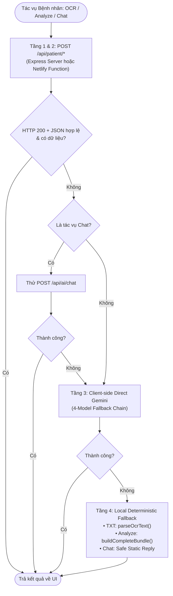

# PHÂN TÍCH CHI TIẾT KỸ THUẬT VÀ THUẬT TOÁN — PHẦN BỆNH NHÂN (PATIENT MODE)
## HỆ THỐNG LUCKY DREAM – EYEAI (EYETALK ASSISTANT)

> **Phạm vi tài liệu**: Phân tích chuyên sâu toàn bộ kiến trúc, kỹ thuật xử lý, thuật toán cốt lõi và luồng dữ liệu của **Phần Bệnh nhân (`account_type = 'patient'`)** trong workspace `eyetalk-assistant`.  
> **Đối tượng sử dụng**: Bệnh nhân tự quản lý sức khỏe và người dùng phổ thông cần quét phiếu xét nghiệm, rà soát chỉ số, nhận giải thích y khoa tham khảo, thực đơn dinh dưỡng, bài tập vận động an toàn và hỏi đáp trợ lý AI bằng văn bản/giọng nói.  
> **Lưu ý phạm vi mã nguồn**: Thư mục `Y-T-AUTO-master` nằm trong workspace là mã nguồn tham chiếu độc lập (Express 5 + SQLite + JWT + OAuth/Phone OTP), **không được import hoặc chạy trực tiếp** bởi ứng dụng `eyetalk-assistant`. Phần Bệnh nhân đang vận hành thực tế nằm trong `src/experiences/patient/*`, `src/services/patient*.ts`, `server/patientBackend.ts`, `netlify/functions/patient.ts`, `supabase/migrations/20260815_*.sql` và các điểm tích hợp trong `src/App.tsx`, `src/hooks/useAuth.ts`, `src/utils/speech.ts`.

---

## MỤC LỤC

1. [Tổng quan Kiến trúc & Cơ chế Phân tách Trải nghiệm](#1-tổng-quan-kiến-trúc--cơ-chế-phân-tách-trải-nghiệm)
2. [Kiến trúc Đa tầng & Chiến lược Dự phòng 4 Tầng (Resilience Pipeline)](#2-kiến-trúc-đa-tầng--chiến-lược-dự-phòng-4-tầng-resilience-pipeline)
3. [Kỹ thuật Tiền xử lý Ảnh & Thuật toán Vision OCR Động](#3-kỹ-thuật-tiền-xử-lý-ảnh--thuật-toán-vision-ocr-động)
4. [Thuật toán Parser Văn bản Cục bộ (`parseOcrText`)](#4-thuật-toán-parser-văn-bản-cục-bộ-parseocrtext)
5. [Quy trình Rà soát Human-in-the-Loop & Chuẩn hóa Dữ liệu](#5-quy-trình-rà-soát-human-in-the-loop--chuẩn-hóa-dữ-liệu)
6. [Thuật toán Phân tích Y khoa, Gợi ý Thực đơn & Vận động (LLM + Rule Engine)](#6-thuật-toán-phân-tích-y-khoa-gợi-ý-thực-đơn--vận-động-llm--rule-engine)
7. [Kỹ thuật Verified Media Trust & Chống Ảo giác Tài nguyên](#7-kỹ-thuật-verified-media-trust--chống-ảo-giác-tài-nguyên)
8. [Lưu trữ Kép (Dual-Storage), Mã hóa Định tính & Bảo mật RLS](#8-lưu-trữ-kép-dual-storage-mã-hóa-định-tính--bảo-mật-rls)
9. [Trợ lý Chatbot Sức khỏe Đa phương thức (STT + Context AI + TTS Đa nền tảng)](#9-trợ-lý-chatbot-sức-khỏe-đa-phương-thức-stt--context-ai--tts-đa-nền-tảng)
10. [Tổng hợp Bảng Tham chiếu File Nguồn & Nhận định Kỹ thuật Thực tế](#10-tổng-hợp-bảng-tham-chiếu-file-nguồn--nhận-định-kỹ-thuật-thực-tế)

---

## 1. TỔNG QUAN KIẾN TRÚC & CƠ CHẾ PHÂN TÁCH TRẢI NGHIỆM

Hệ thống `eyetalk-assistant` phục vụ đồng thời hai nhóm đối tượng qua cùng một mã nguồn React 19 + TypeScript + Supabase + Express/Netlify nhưng cô lập hoàn toàn không gian tính năng dựa trên trường `account_type` (`'impaired'` hoặc `'patient'`):

* **Định nghĩa phân loại tài khoản** ([`account.ts`](file:///c:/Users/Admin/Downloads/eyetalk-assistant/src/types/account.ts)):
  * `'impaired'` (*Người suy giảm*): Giao tiếp bằng mắt (MediaPipe FaceMesh), bàn phím ảo Telex, SOS 8 giây, vị trí, danh bạ, giải trí.
  * `'patient'` (*Bệnh nhân*): Quản lý và giải mã phiếu kết quả xét nghiệm y tế bằng OCR + AI + Rule Engine + Chatbot sức khỏe.

### 1.1. Kỹ thuật Định tuyến & Đồng bộ Vai trò (Account-Type Routing)

1. **Tầng Database & Trigger tự động** ([`20260815_account_type.sql`](file:///c:/Users/Admin/Downloads/eyetalk-assistant/supabase/migrations/20260815_account_type.sql)):
   * Bổ sung cột `account_type` vào bảng `public.profiles` với ràng buộc `CHECK (account_type IS NULL OR account_type IN ('impaired', 'patient'))`.
   * Trigger `public.handle_new_user()` gắn vào `AFTER INSERT ON auth.users` tự động đọc `raw_user_meta_data->>'account_type'` (fallback sang `'role'`), chuẩn hóa về hợp lệ rồi `UPSERT` vào `public.profiles`.
2. **Tầng Đăng ký, Đăng nhập & Demo nhanh** ([`RegisterForm.tsx`](file:///c:/Users/Admin/Downloads/eyetalk-assistant/src/components/auth/RegisterForm.tsx), [`LoginForm.tsx`](file:///c:/Users/Admin/Downloads/eyetalk-assistant/src/components/auth/LoginForm.tsx), [`useAuth.ts`](file:///c:/Users/Admin/Downloads/eyetalk-assistant/src/hooks/useAuth.ts)):
   * `RegisterForm` thiết kế theo quy trình 2 bước: Bước 1 chọn vai trò (`'impaired'` | `'patient'`), Bước 2 điền thông tin tài khoản và đồng bộ `account_type` lên cả `auth.users` metadata lẫn `public.profiles`.
   * `LoginForm` tích hợp nút Quick Demo cho Bệnh nhân (`handleQuickDemo(2)`: email `benhnhan2@eyetalk.app`, tên `Trần Thị Bình`, vai trò `'patient'`).
   * `useAuth` chuẩn hóa hồ sơ qua `fetchProfile()`: ưu tiên `data.account_type || data.role || metaRole`, cung cấp `updateAccountType()` để chuyển đổi chế độ trực tiếp trong [`SettingsPage.tsx`](file:///c:/Users/Admin/Downloads/eyetalk-assistant/src/pages/SettingsPage.tsx).
3. **Experience Router Engine & Cô lập Cảm biến Mắt** ([`App.tsx`](file:///c:/Users/Admin/Downloads/eyetalk-assistant/src/App.tsx)):
   * **Bảo vệ Route hai chiều**: Khi `profile?.account_type === 'patient'`, mọi điều hướng nhầm vào nhóm route của `'impaired'` (`home`, `speak`, `ai`, `sos`, `entertainment`, `location`, `contacts`, `chat`, `dev-dashboard`) lập tức bị chuyển hướng về `'patient-home'`.
   * **5 Route chuyên biệt của Bệnh nhân**:
     * `patient-home` $\rightarrow$ [`PatientDashboardPage.tsx`](file:///c:/Users/Admin/Downloads/eyetalk-assistant/src/experiences/patient/pages/PatientDashboardPage.tsx)
     * `patient-scan` $\rightarrow$ [`PatientScanPage.tsx`](file:///c:/Users/Admin/Downloads/eyetalk-assistant/src/experiences/patient/pages/PatientScanPage.tsx)
     * `patient-review` $\rightarrow$ [`PatientReviewPage.tsx`](file:///c:/Users/Admin/Downloads/eyetalk-assistant/src/experiences/patient/pages/PatientReviewPage.tsx)
     * `patient-analysis` $\rightarrow$ [`PatientAnalysisPage.tsx`](file:///c:/Users/Admin/Downloads/eyetalk-assistant/src/experiences/patient/pages/PatientAnalysisPage.tsx)
     * `patient-history` $\rightarrow$ [`PatientHistoryPage.tsx`](file:///c:/Users/Admin/Downloads/eyetalk-assistant/src/experiences/patient/pages/PatientHistoryPage.tsx)
   * **Tự động tắt Engine Eye Tracking & Camera HUD**:
     * Trong `App.tsx` (dòng 65–69), `useEffect` theo dõi `profile?.account_type === 'patient' && settings.eyeControlEnabled` để tự động gọi `setEyeControlEnabled(false)`.
     * Trong [`EyeTrackingProvider.tsx`](file:///c:/Users/Admin/Downloads/eyetalk-assistant/src/modules/eye-control/EyeTrackingProvider.tsx) (dòng 1640–1646), khi `eyeControlEnabled === false`, hàm `stopTrackingLoop()` được kích hoạt để ngắt vòng lặp `requestAnimationFrame` của MediaPipe FaceMesh, giải phóng CPU/camera.
     * [`GlobalEyeHUD.tsx`](file:///c:/Users/Admin/Downloads/eyetalk-assistant/src/components/ui/GlobalEyeHUD.tsx) và [`PageHeader.tsx`](file:///c:/Users/Admin/Downloads/eyetalk-assistant/src/components/ui/PageHeader.tsx) kiểm tra `profile?.account_type === 'patient' || currentRoute.startsWith('patient-')` để ẩn toàn bộ Camera HUD, nút `EYE MODE ON/OFF` và `KeyboardHudSlot`.
     * [`SettingsPage.tsx`](file:///c:/Users/Admin/Downloads/eyetalk-assistant/src/pages/SettingsPage.tsx) (dòng 477) ẩn khối điều khiển mắt, camera preview, hiệu chuẩn mắt và giả lập bàn phím khi `isPatient === true`, chỉ hiển thị quản lý tài khoản và cấu hình giọng đọc TTS.
     * [`OnboardingModal.tsx`](file:///c:/Users/Admin/Downloads/eyetalk-assistant/src/components/ui/OnboardingModal.tsx) đổi bộ slide sang quy trình 4 bước phân tích xét nghiệm cho bệnh nhân.
   * *Ghi nhận về tái sử dụng component*: Các nút bấm [`AppButton.tsx`](file:///c:/Users/Admin/Downloads/eyetalk-assistant/src/components/ui/AppButton.tsx) và nút quay lại/cài đặt trên `PageHeader` trong các trang Bệnh nhân vẫn bọc trong [`EyeFocusable.tsx`](file:///c:/Users/Admin/Downloads/eyetalk-assistant/src/modules/eye-control/EyeFocusable.tsx). Vì `isFocused = settings.eyeControlEnabled && activeFocusId === id`, vòng sáng Focus Ring bị vô hiệu hóa ở Patient Mode, nhưng click chuột/chạm vẫn đi qua `EyeFocusable.handleSelect` (tích hợp chống nhấn đúp `350ms` và tự động đọc `"Đã chọn ..."` qua `speakVietnamese()` nếu loa đang bật).

```mermaid
flowchart LR
    AUTH["Supabase Auth + profiles.account_type"] --> CHECK{"account_type === 'patient'?"}
    CHECK -- Có --> DISABLE_EYE["setEyeControlEnabled(false)\nstopTrackingLoop() + Ẩn GlobalEyeHUD"]
    DISABLE_EYE --> P_DASH["patient-home\nPatientDashboardPage"]
    P_DASH --> P_SCAN["patient-scan\nPatientScanPage"]
    P_SCAN -->|reportId + OcrResultItem[]| P_REV["patient-review\nPatientReviewPage"]
    P_REV -->|AnalysisBundle| P_ANA["patient-analysis\nPatientAnalysisPage"]
    P_DASH --> P_HIS["patient-history\nPatientHistoryPage"]
    P_HIS -->|select reportId| P_ANA
    P_DASH -.-> CHAT["PatientChatWidget\n(STT + Gemini + TTS)"]
    P_ANA -.-> CHAT
```

---

## 2. KIẾN TRÚC ĐA TẦNG & CHIẾN LƯỢC DỰ PHÒNG 4 TẦNG (RESILIENCE PIPELINE)

Để đảm bảo phần Bệnh nhân hoạt động ổn định trên cả môi trường **Full-stack Node/Express**, **Netlify Serverless**, lẫn **Static Edge / Offline**, các tác vụ nặng (`scanOcr`, `confirmAnalysis`, `sendPatientChatMessage`) trong [`patientService.ts`](file:///c:/Users/Admin/Downloads/eyetalk-assistant/src/services/patientService.ts) áp dụng mô hình **Multi-tier Execution & Model Fallback**.

### 2.1. Phân tầng Hạ tầng Thực thi

| Tầng | Nơi thực thi | Cơ chế định tuyến / kích hoạt | File nguồn |
| :--- | :--- | :--- | :--- |
| **Tầng 1: Express API Router** | Node.js Server (Dev/Docker) | `app.use("/api/patient", createPatientRouter(ai, apiKey))`, giới hạn payload JSON `25mb`. | [`server.ts`](file:///c:/Users/Admin/Downloads/eyetalk-assistant/server.ts), [`patientBackend.ts`](file:///c:/Users/Admin/Downloads/eyetalk-assistant/server/patientBackend.ts) |
| **Tầng 2: Netlify Functions** | Serverless V2 (`Request/Response`) & V1 (`handler(event)`) | [`netlify.toml`](file:///c:/Users/Admin/Downloads/eyetalk-assistant/netlify.toml) chuyển `/api/patient/*` $\rightarrow$ `/.netlify/functions/patient` (`status = 200`, `force = true`). | [`patient.ts`](file:///c:/Users/Admin/Downloads/eyetalk-assistant/netlify/functions/patient.ts) |
| **Tầng 3: Direct Client Gemini** | Trình duyệt người dùng | Kích hoạt khi endpoint `/api/patient/*` trả lỗi/404/non-JSON hoặc kết quả rỗng; đọc khóa từ `VITE_GEMINI_API_KEY` / `GEMINI_API_KEY` (khai báo trong [`vite.config.ts`](file:///c:/Users/Admin/Downloads/eyetalk-assistant/vite.config.ts)). | [`patientService.ts`](file:///c:/Users/Admin/Downloads/eyetalk-assistant/src/services/patientService.ts) |
| **Tầng 4: Local Rule Engine** | Trình duyệt người dùng | Chạy hoàn toàn offline không cần mạng/API key: `parseOcrText()` cho tệp `.txt` và `buildCompleteBundle()` cho phân tích/thực đơn/bài tập. | [`patientOcrNormalizer.ts`](file:///c:/Users/Admin/Downloads/eyetalk-assistant/src/services/patientOcrNormalizer.ts), [`patientAnalysisService.ts`](file:///c:/Users/Admin/Downloads/eyetalk-assistant/src/services/patientAnalysisService.ts) |

### 2.2. Kỹ thuật Bộ định tuyến Ẩn trên Serverless (`detectAction`)

Trong [`netlify/functions/patient.ts`](file:///c:/Users/Admin/Downloads/eyetalk-assistant/netlify/functions/patient.ts) (dòng 387–400), một Netlify Function duy nhất phục vụ cả 3 endpoint (`/ocr`, `/analyze`, `/chat`) cho cả runtime V2 và V1 nhờ hàm `detectAction(urlStr, body)`:
1. Kiểm tra URL suffix/path: chứa `"/ocr"` $\rightarrow$ `ocr`, `"/analyze"` $\rightarrow$ `analyze`, `"/chat"` $\rightarrow$ `chat`.
2. **Heuristic Body Inspection (Fallback)**: Nếu URL bị rewrite mất path, tự suy diễn theo cấu trúc body: có `fileBase64` hoặc `fileName` $\rightarrow$ `ocr`; có `results` kèm `reportId` hoặc `age` $\rightarrow$ `analyze`; có `message` $\rightarrow$ `chat`.

### 2.3. Chuỗi Dự phòng 4 Mô hình Gemini & Chuẩn hóa JSON

Cả Backend (`patientBackend.ts`, `patient.ts`) và Client (`patientService.ts`) đều thử tuần tự danh sách 4 model:

```text
gemini-3.5-flash  ──(lỗi)──►  gemini-3.5-flash-lite  ──(lỗi)──►  gemini-flash-lite-latest  ──(lỗi)──►  gemini-3.8-flash
```

* Với tác vụ **OCR** và **Analyze**, cấu hình `responseMimeType: "application/json"` được bật để ép Structured JSON Output.
* Chuỗi phản hồi thô trước khi `JSON.parse()` luôn đi qua bộ làm sạch markdown code fence (`^```json ... ```$` hoặc `^``` ... ```$`).
* Riêng `sendPatientChatMessage()` trong `patientService.ts` chèn thêm một tầng trung gian thử `/api/ai/chat` ([`ai-chat.ts`](file:///c:/Users/Admin/Downloads/eyetalk-assistant/netlify/functions/ai-chat.ts) / `server.ts`) trước khi chuyển sang gọi Gemini trực tiếp ở client và cuối cùng trả về thông điệp tư vấn an toàn mặc định.



---

## 3. KỸ THUẬT TIỀN XỬ LÝ ẢNH & THUẬT TOÁN VISION OCR ĐỘNG

### 3.1. Thuật toán Co dãn & Nén Ảnh Phía Client (`resizeImageIfNeeded`)

Cài đặt trong [`patientService.ts`](file:///c:/Users/Admin/Downloads/eyetalk-assistant/src/services/patientService.ts) (dòng 73–131), nhằm giải quyết giới hạn payload 6MB của Netlify Serverless Function và giảm độ trễ tải ảnh chụp độ phân giải lớn từ camera điện thoại:

1. **Điều kiện Bypass (Giữ nguyên chất lượng gốc)**:
   * Nếu `width <= 2048` **và** `height <= 2048` **và** `file.size < 1.5 * 1024 * 1024` (1.5 MB), trả về DataURL gốc từ `FileReader`.
2. **Thuật toán Scale đẳng hướng (Aspect-Ratio Preserving Downscale)** với `maxDimension = 2048`:
   $$\text{if } w > h: \quad h' = \text{round}\left(\frac{h \times 2048}{w}\right), \quad w' = 2048$$
   $$\text{if } h \ge w: \quad w' = \text{round}\left(\frac{w \times 2048}{h}\right), \quad h' = 2048$$
3. **Nén JPEG Lossy có kiểm soát**:
   * Vẽ ảnh lên HTML5 `<canvas>` kích thước $(w', h')$ và xuất chuỗi base64 bằng `canvas.toDataURL('image/jpeg', 0.92)` (chất lượng 92% đủ sắc nét để đọc chữ số thập phân nhỏ trên phiếu xét nghiệm nhưng giảm mạnh dung lượng).
4. **Hỗ trợ đa định dạng đầu vào** ([`PatientScanPage.tsx`](file:///c:/Users/Admin/Downloads/eyetalk-assistant/src/experiences/patient/pages/PatientScanPage.tsx)):
   * Cho phép kéo thả (Drag & Drop), chọn file (`image/*`, `application/pdf`, `text/plain`) và kích hoạt trực tiếp camera sau trên thiết bị di động qua thuộc tính `input.capture = 'environment'`.
   * Ở backend `patientBackend.ts` và `patientService.ts`, chuỗi `fileBase64` được tách phần header `data:...;base64,` và loại bỏ ký tự trắng (`replace(/\s+/g, '')`). Nếu `mimeType === 'text/plain'`, server decode base64 thành UTF-8 text; nếu là ảnh hoặc PDF, gửi dưới dạng `inlineData` multimodal cho Gemini.

### 3.2. Kỹ thuật Prompting cho Vision OCR Động (Schema Extraction)

Thay vì dùng danh sách chỉ số cứng (whitelist), prompt OCR trong `patientBackend.ts`, `patient.ts` và `patientService.ts` thiết lập 6 nguyên tắc bắt buộc:

1. **Trích xuất động không giới hạn**: Đọc toàn bộ mọi chỉ số xuất hiện (Huyết học, Sinh hóa máu, Miễn dịch, Nước tiểu, Vi sinh...).
2. **Chống bịa đặt (Anti-Hallucination)**: Chỉ trích xuất những gì có thật trên phiếu; nếu thiếu tên cơ sở y tế, tên bệnh nhân, ngày lấy mẫu hoặc khoảng tham chiếu thì trả `null`.
3. **Ước lượng độ tin cậy & Đánh dấu Nghi ngờ (Uncertainty Flagging)**:
   * Trường rõ ràng: `isUncertain = false`, `ocrConfidence >= 0.90`, `note = null`.
   * Trường mờ, có nếp gấp, mất nét thập phân: `isUncertain = true`, `ocrConfidence < 0.70` (mẫu `0.5 - 0.65`), `flag = "UNCERTAIN"`, kèm mô tả lý do cụ thể trong `note`.
4. **Phân tách Định lượng / Định tính (`valueType`)**:
   * `NUMERIC`: giá trị kiểu số (`7.2`, `112`).
   * `QUALITATIVE`: giá trị chuỗi (`"Âm tính"`, `"Dương tính"`, `"Vàng trong"`, `"Không tìm thấy"`).
5. **Bảo toàn Khoảng tham chiếu gốc (`referenceRange`)**: Trích xuất `{ low, high, text }` đúng theo bản in của phòng xét nghiệm, tuyệt đối không tự suy diễn ngưỡng lâm sàng.
6. **Gán nhãn cờ sơ bộ (`flag`)**: `NORMAL` | `LOW` | `HIGH` | `ABNORMAL` | `UNCERTAIN` | `UNKNOWN`.

---

## 4. THUẬT TOÁN PARSER VĂN BẢN CỤC BỘ (`parseOcrText`)

Cài đặt trong [`patientOcrNormalizer.ts`](file:///c:/Users/Admin/Downloads/eyetalk-assistant/src/services/patientOcrNormalizer.ts), đóng vai trò **Deterministic Local Parser** khi người dùng tải lên tệp `.txt` mà backend không xử lý hoặc ở chế độ fallback.

### 4.1. Từ điển Bổ sung Metadata (Non-Filtering Enrichment Dictionary)

* `KNOWN_TEST_HINTS` chứa 21 mã xét nghiệm phổ biến (`WBC`, `RBC`, `HGB`, `HCT`, `PLT`, `ALT`, `AST`, `GGT`, `CREATININE`, `UREA`, `GLUCOSE`, `HBA1C`, `CHOLESTEROL`, `TRIGLYCERIDE`, `LDL`, `HDL`, `URIC`, `URIC_ACID`, `BILIRUBIN_TP`, `TSH`, `FT4`).
* **Quy tắc thiết kế**: Từ điển này **chỉ bổ sung** tên tiếng Việt, đơn vị hoặc khoảng tham chiếu dự phòng khi văn bản thô bị thiếu; **không bao giờ** lọc bỏ các mã chỉ số không nằm trong từ điển.

### 4.2. Thuật toán Phân tích Hai Nhánh Theo Dòng

Đầu vào `rawText` được tách theo dòng (`/\r?\n/`), cắt khoảng trắng và loại bỏ dòng rỗng. Với mỗi dòng:

1. **Nhánh 1 — Định dạng Có cấu trúc phân cách `|` (`CODE | NAME | VALUE | UNIT | REFERENCE`)**:
   * Chuẩn hóa `testCode = parts[0].toUpperCase().replace(/\s+/g, '_')`.
   * Chuẩn hóa số qua `parseNumber(raw)`: đổi `,` thành `.`, lọc giữ `[^\d.\-]`, kiểm tra `Number.isFinite()`. Nếu phân tích được số $\rightarrow$ `NUMERIC`, ngược lại $\rightarrow$ `QUALITATIVE`.
   * Trích xuất cận dưới/trên của `referenceRange` bằng biểu thức chính quy hỗ trợ nhiều ký tự gạch nối (`-`, `–`, `—`, `~`):
     `/(\d+(?:[.,]\d+)?)\s*[-–—~]\s*(\d+(?:[.,]\d+)?)/`
2. **Nhánh 2 — Định dạng Tự do (Unstructured Line Parsing)**:
   * **Trích xuất mã chỉ số**: Khớp token đầu tiên dạng `/\b([A-Za-z][A-Za-z0-9_\-]{1,12})\b/`.
   * **Lọc nhiễu tiêu đề (Noise Filtering)**: Bỏ qua dòng bắt đầu bằng các từ khóa hành chính (`KẾT`, `QUẢ`, `XÉT`, `NGHIỆM`, `BỆNH`, `VIỆN`, `NGÀY`, `THÁNG`, `NĂM`, `NAME`, `DATE`, `PAGE`, `TRANG`).
   * **Ưu tiên định tính trước định lượng**: Khớp cụm từ định tính tiếng Việt/Anh (`Âm tính`, `Dương tính`, `Negative`, `Positive`, `Không tìm thấy`, `Vàng trong`, `Bình thường`) trước khi tìm số thực đầu tiên.
   * **Trích xuất khoảng tham chiếu cuối dòng**: Dùng global regex `/(\d+(?:[.,]\d+)?)\s*[-–—~]\s*(\d+(?:[.,]\d+)?)/g` và **chọn match cuối cùng** trên dòng (vì trong bảng xét nghiệm, cột khoảng tham chiếu thường nằm sau cột kết quả). Nếu không tìm thấy trên dòng mới lấy fallback từ `KNOWN_TEST_HINTS`.
3. **Phát hiện dấu hiệu nghi ngờ**: Kiểm tra sự xuất hiện của ký tự `?` hoặc `*` trên dòng $\rightarrow$ gán `isUncertain = true`, `ocrConfidence = 0.6`, `flag = 'UNCERTAIN'` (ngược lại `0.95` cho pipe syntax hoặc `0.92` cho dòng tự do).

---

## 5. QUY TRÌNH RÀ SOÁT HUMAN-IN-THE-LOOP & CHUẨN HÓA DỮ LIỆU

File [`PatientReviewPage.tsx`](file:///c:/Users/Admin/Downloads/eyetalk-assistant/src/experiences/patient/pages/PatientReviewPage.tsx) thực thi chốt kiểm soát an toàn **Human-in-the-Loop** giữa bước OCR và bước phân tích AI:

1. **Cơ chế Làm nổi bật Chỉ số Độ tin cậy thấp**:
   * Khi khởi tạo state `rows`, mỗi dòng được tính:
     $$\text{isLowConfidence} = \text{row.isUncertain} \;\lor\; (\text{row.ocrConfidence} < 0.7)$$
   * Các hàng thỏa điều kiện trên tự động đổi viền/nền cảnh báo màu hổ phách (`border-amber-400 bg-amber-50/70`), gắn huy hiệu `"Cần rà soát kỹ (XX%)"` và hiển thị hộp `row.note` nếu có. Thanh tóm tắt phía trên đếm trực tiếp `uncertainCount` để cảnh báo bệnh nhân.
2. **Chỉnh sửa Động Toàn phần**:
   * Cho phép sửa cả 7 thuộc tính trên từng dòng (`testCode`, `testName`, `value`, `unit`, `referenceLow`, `referenceHigh`, `referenceText`), thêm mới dòng (`addRow` với mã mặc định `'CHISO_MOI'`) hoặc xóa dòng dư (`removeRow`).
3. **Thuật toán Chuẩn hóa & Ép kiểu khi Xác nhận (`handleConfirm`)**:
   * Kiểm tra bắt buộc không rỗng cho danh sách, `testCode`, `testName` và `value`.
   * Chuẩn hóa số thập phân theo thói quen nhập tiếng Việt: thay dấu phẩy `,` thành dấu chấm `.` trước khi chạy `Number(...)`.
   * Tự động phân định lại `valueType`: nếu `Number.isFinite(valNum)` $\rightarrow$ `'NUMERIC'` và lưu kiểu `number`; ngược lại $\rightarrow$ `'QUALITATIVE'` và giữ chuỗi.
   * Tự động tổng hợp `referenceText`: nếu người dùng nhập riêng `referenceLow` và `referenceHigh` mà để trống `referenceText`, hệ thống tự tạo chuỗi `"${refLow} - ${refHigh}"` trước khi gửi sang `confirmAnalysis()`.

---

## 6. THUẬT TOÁN PHÂN TÍCH Y KHOA, GỢI Ý THỰC ĐƠN & VẬN ĐỘNG (LLM + RULE ENGINE)

Quá trình phân tích trong `confirmAnalysis()` kết hợp **AI LLM (Gemini)** và **Deterministic Rule Engine** ([`patientAnalysisService.ts`](file:///c:/Users/Admin/Downloads/eyetalk-assistant/src/services/patientAnalysisService.ts)) để vừa có giải thích tự nhiên, vừa đảm bảo tính ổn định, an toàn và khả năng chạy offline.

### 6.1. Chiến lược Prompting An toàn & Hợp nhất Kết quả Hybrid

* **Ngữ cảnh đầu vào**: Danh sách `ConfirmedLabResult[]` đã rà soát + `age` (mặc định `35`) + `gender` (`"Chung"` ở server).
* **Ràng buộc An toàn Y khoa trong Prompt**:
  1. Không tự đặt ngưỡng hay chẩn đoán bệnh, không kê đơn thuốc; mọi nhận xét phải đối chiếu trực tiếp với `referenceText / referenceLow / referenceHigh` trên phiếu.
  2. Bắt buộc đi kèm trường `sourceCitation` trích dẫn tài liệu chuyên môn (Bộ Y tế Việt Nam, VNHA, WHO, ADA...).
  3. Sinh thực đơn đủ 5 bữa (`BREAKFAST`, `LUNCH`, `DINNER`, `SNACK`, `DRINK`) và 2–3 bài tập vận động nhẹ nhàng kèm `duration`, `difficulty`.
* **Kỹ thuật Hybrid Merge ở Client (`performClientAnalysis` trong `patientService.ts`)**:
  * Trước khi trả `AnalysisBundle`, client luôn dựng sẵn `baseBundle = buildCompleteBundle(reportId, confirmedResults, age)`.
  * Mỗi phần tử `mealPlan.items[i]` và `exercisePlan.items[i]` từ Gemini được trộn (`spread`) lên trên phần tử tương ứng của `baseBundle` (`{ ...baseBundle.mealPlan.items[i], ...m }`), đảm bảo kế thừa đầy đủ metadata ảnh Wikimedia / video YouTube đã kiểm chứng mà AI không tự sinh được.
  * Tương tự, tại server (`patientBackend.ts`, `patient.ts`), mỗi món ăn được trộn với `DEFAULT_FOOD_IMAGES[m.mealType]` và mỗi bài tập được trộn vòng tròn với `DEFAULT_EXERCISE_VIDEOS[idx % 3]`.

### 6.2. Thuật toán Phân loại & Giải thích Cục bộ (`patientAnalysisService.ts`)

#### A. Thuật toán Phân loại Trạng thái (`classifyResult`)

```text
Input: ConfirmedLabResult r
1. Nếu r.isUncertain == true (tại generateLabAnalysis) ──► status = 'UNCERTAIN'
2. Nếu r.valueType === 'QUALITATIVE' hoặc typeof r.value === 'string':
     str = lowercase(r.value)
     • chứa 'dương tính' | 'positive' | 'bất thường'        ──► 'ABNORMAL'
     • chứa 'âm tính' | 'negative' | 'bình thường' | 'không tìm thấy' ──► 'NORMAL'
     • ngược lại                                            ──► 'UNKNOWN'
3. Nếu r.valueType === 'NUMERIC':
     num = Number(r.value)
     • !Number.isFinite(num)                                ──► 'UNKNOWN'
     • referenceLow === null && referenceHigh === null      ──► 'UNKNOWN'
     • referenceLow !== null && num < referenceLow          ──► 'LOW'
     • referenceHigh !== null && num > referenceHigh        ──► 'HIGH'
     • ngược lại                                            ──► 'NORMAL'
```

#### B. Thuật toán Ánh xạ Căn cứ Y khoa theo Nhóm Cơ quan (`explainResult`)

Dựa trên `testCode` viết hoa và từ khóa trong `testName`, hệ thống phân nhánh theo 9 nhóm quy tắc để gán `sourceCitation` chuẩn xác:
1. **Đường huyết** (`GLUCOSE`, `HBA1C`, *"đường"*) $\rightarrow$ *Bộ Y tế / ADA*.
2. **Mỡ máu** (`CHOLESTEROL`, `TRIGLYCERIDE`, `LDL`, `HDL`, *"mỡ máu"*) $\rightarrow$ *Hội Tim mạch học Quốc gia Việt Nam (VNHA)*.
3. **Chức năng gan** (`ALT`, `AST`, `GGT`, `BILIRUBIN`, `BILIRUBIN_TP`, *"men gan"*, *"gan"*) $\rightarrow$ *Hội Gan Mật Việt Nam*.
4. **Chức năng thận & Acid Uric** (`CREATININE`, `UREA`, `BUN`, `URIC`, `URIC_ACID`, *"thận"*) $\rightarrow$ *KDIGO / Bộ Y tế*.
5. **Huyết học** (`WBC`, `RBC`, `HGB`, `HCT`, `PLT`, `NEUT`, `LYMPH`, `MCV`, `MCH`, *"bạch cầu"*, *"hồng cầu"*, *"tiểu cầu"*, *"huyết sắc tố"*) $\rightarrow$ *Viện Huyết học Truyền máu Trung ương*.
6. **Tuyến giáp** (`TSH`, `FT3`, `FT4`, `T3`, `T4`, *"tuyến giáp"*) $\rightarrow$ *Hội Nội tiết & Đái tháo đường Việt Nam (VADE)*.
7. **Điện giải** (`NA`, `K`, `CL`, `CALCIUM`, `CA`, *"điện giải"*) $\rightarrow$ *Bộ Y tế*.
8. **Nước tiểu** (`U_*`, `*URINE*`, *"nước tiểu"*) $\rightarrow$ *Bộ Y tế Việt Nam*.
9. **Chỉ số viêm** (`CRP`, `ESR`, `PROCALCITONIN`, *"viêm"*) $\rightarrow$ *Bộ Y tế*.
* Mặc định cho các chỉ số khác: *Hướng dẫn Thực hành Xét nghiệm Lâm sàng - Bộ Y tế Việt Nam*.

Mọi `overallSummary` trong `generateLabAnalysis()` đều đếm tách biệt 3 tập: `abnormal` (`LOW | HIGH | ABNORMAL`), `uncertain` (`UNCERTAIN`), `unknown` (`UNKNOWN`) và luôn nối thêm câu miễn trừ trách nhiệm y khoa (*disclaimer*).

#### C. Thuật toán Cá nhân hóa Thực đơn Rule-based (`generateMealPlan`)

Hệ thống quét danh sách `analyzed` để rút trích 6 cờ bệnh lý/chuyển hóa:
* `lowRbc`: `RBC`/`HGB` có status `LOW` $\rightarrow$ ưu tiên món sáng giàu sắt (*Phở bò tái nạc rau thơm* + ảnh `'beef-noodle-breakfast'`); các trường hợp khác dùng *Bánh mì nguyên cám, trứng áp chảo và dưa leo* (`'egg-toast-breakfast'`).
* `highGlucose`: `GLUCOSE`/`HBA1C` có status `HIGH` $\rightarrow$ nhấn mạnh tinh bột hấp thu chậm cho bữa sáng, bữa phụ ít ngọt.
* `highLipid`: `CHOLESTEROL`/`TRIGLYCERIDE`/`LDL` có status `HIGH` $\rightarrow$ gợi ý bữa trưa cá giàu omega-3 và giảm mỡ bão hòa.
* `highUric`: `URIC`/`URIC_ACID` có status `HIGH` $\rightarrow$ kiềm hóa khẩu phần, giảm purin, uống đủ nước tăng đào thải.
* `highLiver`: `ALT`/`AST`/`GGT`/`SGPT`/`SGOT` có status `HIGH` $\rightarrow$ ưu tiên chế biến hấp/luộc thanh đạm giảm tải gan.
* `highKidney`: `CREATININE`/`UREA`/`BUN` có status `HIGH` $\rightarrow$ kiểm soát muối, đạm động vật vừa phải, canh thanh đạm buổi tối.

#### D. Thuật toán Điều chỉnh Bài tập theo Tuổi & Chỉ số (`generateExercisePlan`)

Sử dụng biến phân tầng độ tuổi `isSenior = age >= 60` kết hợp 3 cờ xét nghiệm (`highGlucoseOrLipid`, `highUric`, `lowRbc`):

| Tiêu chí | Bài tập 1 (Hiếu khí / Đi bộ) | Bài tập 2 (Kéo giãn / Yoga) |
| :--- | :--- | :--- |
| **Thời lượng (`duration`)** | `15` phút nếu `isSenior \|\| lowRbc`<br>`30` phút nếu `highGlucoseOrLipid`<br>`25` phút (mặc định) | `15` phút nếu `isSenior`<br>`20` phút (mặc định) |
| **Lựa chọn bài tập & Video** | *Đi bộ thư giãn cự ly ngắn* (nếu `isSenior \|\| lowRbc`) hoặc *Đi bộ nhịp điệu tại nhà* $\rightarrow$ Video `'walk-at-home'` | **Bảo vệ khớp / Tuổi cao**: nếu `isSenior \|\| highUric` chọn *Yoga ghế nhẹ nhàng bảo vệ khớp* (`'chair-yoga'`), ngược lại chọn *Yoga kéo giãn cơ bản phục hồi* (`'beginner-yoga'`) |
| **Mức độ (`difficulty`)** | `'EASY'` | `'EASY'` |

---

## 7. KỸ THUẬT VERIFIED MEDIA TRUST & CHỐNG ẢO GIÁC TÀI NGUYÊN

Một kỹ thuật bảo vệ chất lượng nội dung quan trọng trong Phần Bệnh nhân là **không bao giờ để AI tự bịa đặt URL hình ảnh hoặc link video YouTube**. Toàn bộ tài nguyên đa phương tiện được khóa cứng trong [`patientCatalog.ts`](file:///c:/Users/Admin/Downloads/eyetalk-assistant/src/services/patientCatalog.ts) (và danh mục mặc định tại backend) rồi hiển thị qua component [`VerifiedMedia.tsx`](file:///c:/Users/Admin/Downloads/eyetalk-assistant/src/experiences/patient/components/VerifiedMedia.tsx):

1. **Ảnh món ăn xác thực Wikimedia Commons (`VERIFIED_FOOD_IMAGES`)**:
   * 6 bản ghi cố định (`beef-noodle-breakfast`, `egg-toast-breakfast`, `fish-rice-lunch`, `vegetable-soup-dinner`, `fruit-nuts-snack`, `green-tea-drink`).
   * Mỗi bản ghi lưu đủ thông tin ghi công bản quyền: `imageUrl`, `sourceUrl`, `alt`, `license` (`CC0` hoặc `CC BY-SA 4.0`), `author`.
   * Giao diện `VerifiedMedia` hiển thị huy hiệu `"Wikimedia Verified"`, tên tác giả, giấy phép và liên kết tới trang nguồn gốc; nếu ảnh lỗi mạng (`onError`), tự chuyển sang thẻ thông báo dự phòng thay vì hiển thị ảnh vỡ.
2. **Video bài tập xác thực YouTube (`VERIFIED_EXERCISE_VIDEOS`)**:
   * 3 video cố định (`walk-at-home`, `beginner-yoga`, `chair-yoga`) kèm `videoId`, `title`, `authorName`, `authorUrl`, `youtubeUrl`.
   * Nhúng trình phát qua `<iframe>` `https://www.youtube.com/embed/${exercise.youtubeVideoId}` kèm link dẫn trực tiếp về kênh tác giả.
   * *(Ghi chú sai lệch nhỏ trong mã nguồn)*: Video `chair-yoga` trong `patientCatalog.ts` dùng ID `'1DYH5ud3zHo'` (*Gentle Chair Yoga for Beginners and Seniors* — Yoga with Kassandra), trong khi `DEFAULT_EXERCISE_VIDEOS` ở `patientBackend.ts` và `netlify/functions/patient.ts` dùng ID `'E_gi_O71e_4'` (*Gentle Chair Yoga Routine | Safe Movement* — Senior Fitness With Meredith).

---

## 8. LƯU TRỮ KÉP (DUAL-STORAGE), MÃ HÓA ĐỊNH TÍNH & BẢO MẬT RLS

### 8.1. Thiết kế Cơ sở dữ liệu PostgreSQL & Row Level Security (`20260815_patient_tables.sql`)

Schema dữ liệu bệnh nhân trong [`20260815_patient_tables.sql`](file:///c:/Users/Admin/Downloads/eyetalk-assistant/supabase/migrations/20260815_patient_tables.sql) gồm 6 bảng quan hệ phân tầng xóa dây chuyền (`ON DELETE CASCADE`):
* `lab_reports` $\rightarrow$ `lab_results`
* `meal_plans` (gắn `report_id`) $\rightarrow$ `meal_plan_items`
* `exercise_plans` (gắn `report_id`) $\rightarrow$ `exercise_items`

**Bảo mật cấp dòng (RLS)**:
* Cả 6 bảng đều bật `ENABLE ROW LEVEL SECURITY`.
* Bảng cha (`lab_reports`, `meal_plans`, `exercise_plans`) kiểm tra trực tiếp `auth.uid() = user_id`.
* Bảng con (`lab_results`, `meal_plan_items`, `exercise_items`) kiểm tra quyền sở hữu gián tiếp qua truy vấn `EXISTS` đối chiếu `parent.user_id = auth.uid()`.

### 8.2. Chiến lược Dual-Storage & Mã hóa Giá trị Định tính

Trong [`patientService.ts`](file:///c:/Users/Admin/Downloads/eyetalk-assistant/src/services/patientService.ts), dữ liệu được đồng bộ song song giữa `localStorage` và Supabase:

1. **Local Cache tức thì**:
   * Danh sách lịch sử lưu tại khóa `eyetalk_patient_reports`.
   * Chi tiết toàn bộ `AnalysisBundle` (bao gồm giải thích của AI, `mealPlan`, `exercisePlan`) lưu theo từng khóa `eyetalk_patient_bundles_${reportId}`.
   * Giúp ứng dụng chạy mượt ngay cả khi mất mạng hoặc khi Supabase dùng cấu hình fallback placeholder trong [`supabase.ts`](file:///c:/Users/Admin/Downloads/eyetalk-assistant/src/lib/supabase.ts).
2. **Kỹ thuật Mã hóa Giá trị Định tính vào Cột `NUMERIC` (Type-Safe Qualitative Encoding)**:
   * Vì cột `lab_results.value` trong SQL có kiểu `NUMERIC NOT NULL`, khi lưu kết quả định tính (như `"Âm tính"`), `confirmAnalysis()` ép `value` về `0` (`Number.isFinite(numVal) ? numVal : 0`) và ghi giá trị chuỗi vào cột `explanation` theo định dạng:
     `"[Định tính: <chuỗi giá trị>]"`
   * Khi tải lại báo cáo từ Supabase trong `getReportDetail()` (khi không có cache trong `localStorage`), hệ thống giải mã tiền tố `"[Định tính: "` để khôi phục đúng `valueType = 'QUALITATIVE'` và tái tạo lại `AnalysisBundle` thông qua `buildCompleteBundle()`.
   * Đồng thời khi cập nhật `lab_results` cho `reportId`, `confirmAnalysis()` thực hiện `delete().eq('report_id', reportId)` rồi `insert(insertRows)` để bảo đảm tập chỉ số khớp với bản rà soát mới nhất.

---

## 9. TRỢ LÝ CHATBOT SỨC KHỎE ĐA PHƯƠNG THỨC (STT + CONTEXT AI + TTS ĐA NỀN TẢNG)

Widget [`PatientChatWidget.tsx`](file:///c:/Users/Admin/Downloads/eyetalk-assistant/src/experiences/patient/components/PatientChatWidget.tsx) xuất hiện ở góc phải dưới trên `PatientDashboardPage` và `PatientAnalysisPage`, kết hợp 3 kỹ thuật:

### 9.1. Context Injection (Nhúng Ngữ cảnh Xét nghiệm)
* Trên `PatientAnalysisPage`, widget nhận props `reportSummary={bundle?.analysis?.overallSummary}` và `labResults={bundle?.analysis?.results}`.
* Tại `/api/patient/chat`, server đóng gói ngữ cảnh thành block `[BỐI CẢNH XÉT NGHIỆM]` + `[CÂU HỎI CỦA NGƯỜI BỆNH]` kèm System Prompt chuyên biệt (giải thích 3–6 câu bằng tiếng Việt dễ hiểu, không tự chẩn đoán hay thay thế bác sĩ).

### 9.2. Nhận diện Giọng nói (Speech-to-Text - STT)
* Sử dụng Web Speech Recognition API (`window.SpeechRecognition || window.webkitSpeechRecognition`) cấu hình `lang = 'vi-VN'`, `interimResults = false`. Khi thu xong câu nói, điền thẳng vào ô nhập liệu để bệnh nhân kiểm tra trước khi gửi.

### 9.3. Động cơ Phát âm Tiếng Việt Đa nền tảng (`src/utils/speech.ts`)

Mỗi phản hồi của chatbot tự động kích hoạt `speakVietnamese(reply)` (và có nút loa trên từng bong bóng chat để nghe lại). Động cơ trong [`speech.ts`](file:///c:/Users/Admin/Downloads/eyetalk-assistant/src/utils/speech.ts) tự động chọn một trong 2 đường dẫn tối ưu theo trình duyệt/hệ điều hành:

1. **Path 1 — Native Local Speech (`hasNativeVietnameseSpeech()`)**:
   * Dùng cho **Microsoft Edge** (giọng *HoaiMy* / *NamMinh*), **Android** (Google tiếng Việt) và **iOS Safari** (AVFoundation `vi-VN`).
   * Hàm `isVietnameseVoice()` kiểm tra nghiêm ngặt `lang` (`vi` / `vi-*`) hoặc tên giọng chứa từ khóa tiếng Việt, tránh chọn nhầm giọng tiếng Anh.
   * **Chống lỗi WebKit Garbage Collection trên iOS Safari**: Lưu tham chiếu `SpeechSynthesisUtterance` vào mảng cấp module `activeUtterances` cho đến khi `onend`/`onerror` chạy xong; đồng thời [`AudioUnlockBanner.tsx`](file:///c:/Users/Admin/Downloads/eyetalk-assistant/src/components/ui/AudioUnlockBanner.tsx) + `unlockAudio()` mở khóa `AudioContext` (bằng 1-sample silent WAV buffer) và prime hàng đợi Speech Queue bằng micro-utterance ở lần chạm đầu tiên.
2. **Path 2 — Serverless Proxy Online TTS + Web Audio API (Desktop Chrome)**:
   * Desktop Chrome trên Windows thường không có giọng SAPI tiếng Việt bản địa, nên hệ thống chuyển qua `playOnlineTTS()`:
   * **Thuật toán Chia đoạn (`splitTextIntoChunks`)**: Làm sạch Markdown qua `cleanTextForSpeech()`, sau đó chia văn bản thành các đoạn $\le 150$ ký tự (ưu tiên tách theo dấu kết thúc câu `[.!?;\n]`, nếu một câu vẫn dài hơn 150 ký tự thì tách tiếp theo ranh giới từ).
   * **Cache RAM & Hủy Fetch Cũ**: Gọi proxy `/api/tts?text=...` (Google Translate TTS qua [`server.ts`](file:///c:/Users/Admin/Downloads/eyetalk-assistant/server.ts) hoặc [`netlify/functions/tts.ts`](file:///c:/Users/Admin/Downloads/eyetalk-assistant/netlify/functions/tts.ts)), decode sang `AudioBuffer` và lưu vào `audioBufferCache` (giới hạn 60 mục) để phát tức thì khi lặp lại; sử dụng `AbortController` (`currentFetchController`) để hủy ngay các request đang chờ nếu người dùng bấm đọc câu mới hoặc dừng đọc (`stopSpeech()`).
   * **Fallback HTMLAudioElement**: Nếu Web Audio `decodeAudioData` không khả dụng, tự động chuyển sang phát qua thẻ `<audio id="eyetalk-shared-audio">` dùng chung.

---

## 10. TỔNG HỢP BẢNG THAM CHIẾU FILE NGUỒN & NHẬN ĐỊNH KỸ THUẬT THỰC TẾ

### 10.1. Bảng Tham chiếu File Nguồn Phần Bệnh nhân

| Thành phần | File Mã Nguồn | Vai trò & Kỹ thuật chính |
| :--- | :--- | :--- |
| **Định tuyến & Cô lập Mode** | [`src/App.tsx`](file:///c:/Users/Admin/Downloads/eyetalk-assistant/src/App.tsx), [`src/types/account.ts`](file:///c:/Users/Admin/Downloads/eyetalk-assistant/src/types/account.ts), [`src/hooks/useAuth.ts`](file:///c:/Users/Admin/Downloads/eyetalk-assistant/src/hooks/useAuth.ts) | Experience Router Engine, tự động tắt Eye Control & ẩn Camera HUD cho `'patient'`. |
| **Giao diện 5 Trang Bệnh nhân** | [`PatientDashboardPage.tsx`](file:///c:/Users/Admin/Downloads/eyetalk-assistant/src/experiences/patient/pages/PatientDashboardPage.tsx), [`PatientScanPage.tsx`](file:///c:/Users/Admin/Downloads/eyetalk-assistant/src/experiences/patient/pages/PatientScanPage.tsx), [`PatientReviewPage.tsx`](file:///c:/Users/Admin/Downloads/eyetalk-assistant/src/experiences/patient/pages/PatientReviewPage.tsx), [`PatientAnalysisPage.tsx`](file:///c:/Users/Admin/Downloads/eyetalk-assistant/src/experiences/patient/pages/PatientAnalysisPage.tsx), [`PatientHistoryPage.tsx`](file:///c:/Users/Admin/Downloads/eyetalk-assistant/src/experiences/patient/pages/PatientHistoryPage.tsx) | Dashboard, Upload/Camera/Dropzone, Rà soát Human-in-the-Loop, Tabs Kết quả/Thực đơn/Bài tập, Lịch sử. |
| **Chatbot & Media Xác thực** | [`PatientChatWidget.tsx`](file:///c:/Users/Admin/Downloads/eyetalk-assistant/src/experiences/patient/components/PatientChatWidget.tsx), [`VerifiedMedia.tsx`](file:///c:/Users/Admin/Downloads/eyetalk-assistant/src/experiences/patient/components/VerifiedMedia.tsx) | Web Speech STT, Context AI Chat, TTS tự động, hiển thị Wikimedia + YouTube IFrame có nguồn bản quyền. |
| **Dịch vụ & Thuật toán Client** | [`patientService.ts`](file:///c:/Users/Admin/Downloads/eyetalk-assistant/src/services/patientService.ts), [`patientOcrNormalizer.ts`](file:///c:/Users/Admin/Downloads/eyetalk-assistant/src/services/patientOcrNormalizer.ts), [`patientAnalysisService.ts`](file:///c:/Users/Admin/Downloads/eyetalk-assistant/src/services/patientAnalysisService.ts), [`patientCatalog.ts`](file:///c:/Users/Admin/Downloads/eyetalk-assistant/src/services/patientCatalog.ts) | Resize ảnh Canvas, Fallback 4 tầng, Parser văn bản, Rule-based Lab/Meal/Exercise Engine, Dual-Storage. |
| **Backend & Serverless** | [`server/patientBackend.ts`](file:///c:/Users/Admin/Downloads/eyetalk-assistant/server/patientBackend.ts), [`netlify/functions/patient.ts`](file:///c:/Users/Admin/Downloads/eyetalk-assistant/netlify/functions/patient.ts), [`netlify.toml`](file:///c:/Users/Admin/Downloads/eyetalk-assistant/netlify.toml) | Multimodal Gemini Vision OCR, LLM Analysis, Health Chat, V1/V2 Serverless Handler. |
| **CSDL & Bảo mật Supabase** | [`20260815_account_type.sql`](file:///c:/Users/Admin/Downloads/eyetalk-assistant/supabase/migrations/20260815_account_type.sql), [`20260815_patient_tables.sql`](file:///c:/Users/Admin/Downloads/eyetalk-assistant/supabase/migrations/20260815_patient_tables.sql) | Bảng `profiles` (`account_type`), 6 bảng dữ liệu bệnh nhân và chính sách RLS. |
| **Giọng nói Tiếng Việt** | [`src/utils/speech.ts`](file:///c:/Users/Admin/Downloads/eyetalk-assistant/src/utils/speech.ts), [`netlify/functions/tts.ts`](file:///c:/Users/Admin/Downloads/eyetalk-assistant/netlify/functions/tts.ts) | Native Speech Synthesis + Google TTS Proxy, Web Audio Buffer Caching, Audio Unlock iOS. |

### 10.2. Các Điểm Giới hạn / Sai lệch Kỹ thuật Quan sát Được Trong Mã Nguồn

Khi đối chiếu trực tiếp mã nguồn hiện tại, có một số điểm kỹ thuật cần lưu ý nếu tiếp tục bảo trì hoặc nâng cấp phần Bệnh nhân:

1. **Định dạng `reportId` vs kiểu cột `UUID` trên Supabase**:
   * `scanOcr()` và `patientBackend.ts` tạo `reportId` theo dạng chuỗi `"rep_" + Date.now() + "_" + random` (không phải UUID v4 chuẩn), trong khi [`20260815_patient_tables.sql`](file:///c:/Users/Admin/Downloads/eyetalk-assistant/supabase/migrations/20260815_patient_tables.sql) khai báo `lab_reports.id UUID` và `lab_results.report_id UUID`. Do đó khi đồng bộ lên PostgreSQL thật, lệnh `insert`/`upsert` vào Supabase có thể bị từ chối kiểu dữ liệu và hệ thống sẽ âm thầm fallback sang lưu trữ cục bộ `localStorage`.
2. **Ràng buộc `CHECK` của `lab_results.status` trong SQL**:
   * Cột `lab_results.status` trong migration SQL hiện chỉ cho phép `('LOW', 'NORMAL', 'HIGH', 'UNKNOWN')`, chưa bao gồm `'ABNORMAL'` và `'UNCERTAIN'` mà [`classifyResult()`](file:///c:/Users/Admin/Downloads/eyetalk-assistant/src/services/patientAnalysisService.ts#L14-L36) có thể sinh ra đối với kết quả định tính dương tính.
3. **Phạm vi đồng bộ bảng Supabase**:
   * Migration đã tạo đủ 6 bảng (`lab_reports`, `lab_results`, `meal_plans`, `meal_plan_items`, `exercise_plans`, `exercise_items`), tuy nhiên [`patientService.ts`](file:///c:/Users/Admin/Downloads/eyetalk-assistant/src/services/patientService.ts) hiện mới đồng bộ lên Supabase 2 bảng `lab_reports` và `lab_results`; toàn bộ `mealPlan`, `exercisePlan` và `explanation` từ Gemini được lưu trong `localStorage` (`eyetalk_patient_bundles_<id>`). Nếu mở lại trên thiết bị khác (mất `localStorage`), `getReportDetail()` sẽ tái tạo `AnalysisBundle` bằng Rule Engine cục bộ `buildCompleteBundle()`.
4. **Cấu hình `age` và `gender` khi gọi phân tích**:
   * Backend `/api/patient/analyze` hỗ trợ tham số `age` và `gender`, nhưng [`PatientReviewPage.tsx`](file:///c:/Users/Admin/Downloads/eyetalk-assistant/src/experiences/patient/pages/PatientReviewPage.tsx#L135) đang gọi `confirmAnalysis(reportId, payload)` không truyền tuổi, nên `age` luôn dùng giá trị mặc định `35` (chưa kích hoạt nhánh `isSenior = age >= 60` trong Rule Engine từ UI).
5. **Khác biệt nhỏ về Video `chair-yoga` giữa Client và Server**:
   * Client catalog ([`patientCatalog.ts`](file:///c:/Users/Admin/Downloads/eyetalk-assistant/src/services/patientCatalog.ts#L100-L108)) gán video `'1DYH5ud3zHo'`, còn danh mục fallback ở server ([`patientBackend.ts`](file:///c:/Users/Admin/Downloads/eyetalk-assistant/server/patientBackend.ts#L78-L86) và [`patient.ts`](file:///c:/Users/Admin/Downloads/eyetalk-assistant/netlify/functions/patient.ts#L73-L81)) gán `'E_gi_O71e_4'`.
6. **Lộ khóa API khi chạy chế độ Client-Direct**:
   * Để hỗ trợ fallback chạy Gemini trực tiếp từ trình duyệt khi không có backend/serverless, [`vite.config.ts`](file:///c:/Users/Admin/Downloads/eyetalk-assistant/vite.config.ts#L9-L13) nhúng `VITE_GEMINI_API_KEY` / `GEMINI_API_KEY` vào bundle frontend (`define`). Trong môi trường production bảo mật cao, nên ưu tiên chỉ gọi qua Express Server hoặc Netlify Function và giới hạn key phía client.
