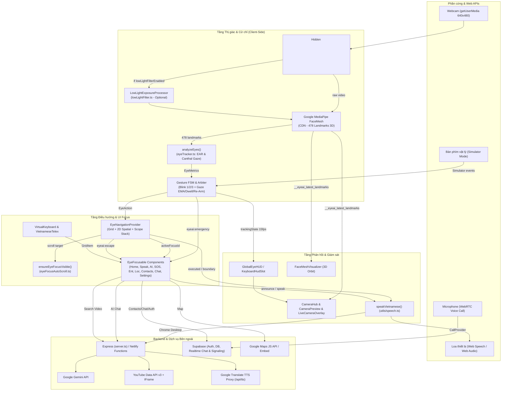
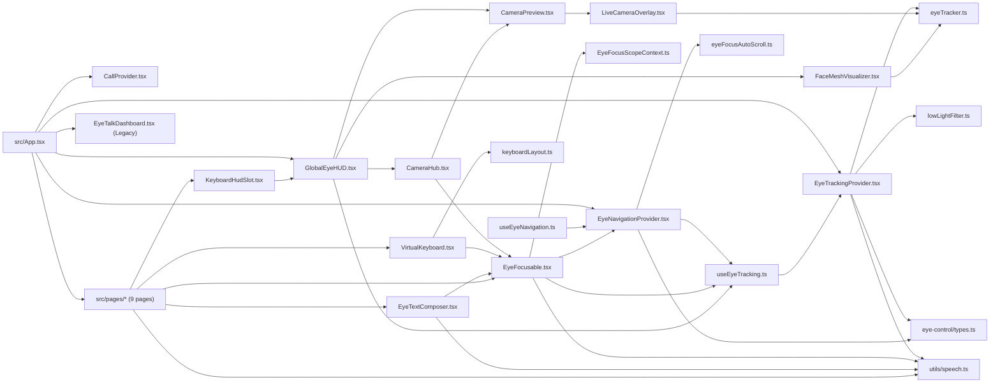

# 01. KIẾN TRÚC TỔNG THỂ PHÂN HỆ NGƯỜI SUY GIẢM (SYSTEM ARCHITECTURE)

## 1. Phạm vi và định vị kiến trúc trong dự án EYEAI

Ứng dụng **LUCKY DREAM – EYEAI** vận hành theo mô hình **Dual-Experience Single-Page Application (SPA)** được điều phối tại [`App.tsx`](file:///c:/Users/Admin/Downloads/eyetalk-assistant/src/App.tsx#L192-L213) dựa trên trường `profile.account_type` từ Supabase Auth/Profiles:

- **`account_type === 'impaired'` (Phân hệ Người suy giảm — trọng tâm tài liệu)**: Giao diện giao tiếp và điều hướng rảnh tay bằng ánh mắt/chớp mắt (`home`, `speak`, `ai`, `sos`, `entertainment`, `location`, `contacts`, `chat`, `dev-dashboard`, `settings`).
- **`account_type === 'patient'` (Phân hệ Bệnh nhân thông thường — ngoài phạm vi phân tích sâu)**: Tự động tắt điều khiển bằng mắt tại [`App.tsx`](file:///c:/Users/Admin/Downloads/eyetalk-assistant/src/App.tsx#L75-L79) và ẩn `GlobalEyeHUD` tại [`App.tsx`](file:///c:/Users/Admin/Downloads/eyetalk-assistant/src/App.tsx#L269-L271).

Kiến trúc phân hệ Người suy giảm được thiết kế theo mô hình **Client-Side Edge Vision + Reactive Focus Tree + Hybrid Cloud Services**:
- Toàn bộ pipeline thị giác máy tính (thu nhận khung hình webcam, tiền xử lý thiếu sáng, suy luận mạng nơ-ron MediaPipe FaceMesh, tính toán hình học mắt, máy trạng thái hữu hạn nhận diện cử chỉ) chạy **100% cục bộ trên trình duyệt (client-side)** để đảm bảo độ trễ thấp và quyền riêng tư hình ảnh khuôn mặt.
- Backend (Express dev server tại [`server.ts`](file:///c:/Users/Admin/Downloads/eyetalk-assistant/server.ts) hoặc Netlify Serverless Functions tại [`netlify/functions/`](file:///c:/Users/Admin/Downloads/eyetalk-assistant/netlify/functions)) và các dịch vụ đám mây (Supabase, Google Gemini, YouTube Data API v3, Google Maps, Google Translate TTS) chỉ đảm nhiệm xác thực, lưu trữ tin nhắn/danh bạ, signaling WebRTC, hội thoại AI, tìm kiếm giải trí và tổng hợp giọng nói dự phòng.

---

## 2. Công nghệ, Framework, Thư viện và Mô hình AI

| Tầng (Layer) | Công nghệ / Thư viện | Phiên bản (`package.json`) | Vai trò thực tế trong phân hệ Người suy giảm |
| :--- | :--- | :--- | :--- |
| **UI Framework** | React & React DOM | `^19.0.1` | Render giao diện reactive, Context API, Hooks, Memoization |
| **Ngôn ngữ & Build** | TypeScript, Vite, Tailwind CSS | `~5.8.2`, `^6.2.3`, `^4.1.14` | Type-safety cho telemetry/landmarks, đóng gói SPA, utility styling |
| **Animation & Focus Ring** | `motion/react` (Framer Motion), `lucide-react` | `^12.23.24`, `^0.546.0` | Hiệu ứng `layoutId="eye-focus-glide-ring"` cho vòng focus mắt, transition trang |
| **Computer Vision / AI Model** | `@mediapipe/face_mesh` & `@mediapipe/camera_utils` (CDN jsDelivr) | Nạp runtime qua CDN (`index.html`, `EyeTrackingProvider.tsx`) | Suy luận 478 điểm mốc khuôn mặt & mống mắt 3D trên trình duyệt |
| **Generative AI** | `@google/genai` (Gemini API) | `^2.4.0` | Trợ lý AI trò chuyện (`AiPage.tsx`, `EyeTalkDashboard.tsx`, `server.ts`, `ai-chat.ts`) |
| **BaaS & Realtime** | `@supabase/supabase-js` | `^2.112.3` | Auth, Profile `account_type`, Friends, Direct Chat (`postgres_changes`), WebRTC Signaling (`broadcast`) |
| **Truyền thông P2P** | WebRTC (`RTCPeerConnection`), `getUserMedia` | Web Standard API | Gọi thoại 1-1 (`CallProvider.tsx`, `webrtcService.ts`) mà không ngắt camera eye-tracking |
| **Giọng nói (TTS)** | Web Speech API (`speechSynthesis`), Web Audio API (`AudioContext`), `/api/tts` | Web API + Proxy Node/Netlify | Phản hồi âm thanh tức thì mọi thao tác mắt và đọc tin nhắn (`src/utils/speech.ts`) |
| **Bản đồ & Định vị** | `@googlemaps/js-api-loader`, Geolocation API | `^2.1.1` + Web API | Hiển thị bản đồ vị trí an toàn & nút điều khiển phóng to/thu nhỏ/căn tâm bằng mắt (`LocationPage.tsx`) |
| **Giải trí** | YouTube Data API v3, YouTube IFrame Player API | REST + IFrame API | Tìm kiếm và điều khiển phát/tạm dừng/tua/âm lượng video bằng mắt (`EntertainmentPage.tsx`, `YouTubePlayerView.tsx`) |
| **Kiểm thử** | Vitest, Testing Library, jsdom, tsx | `^5.1.2`, `^16.3.3`, `^31.0.1` | Unit/Integration test cho `lowLightFilter`, `analyzeEyes`, `EyeTrackingProvider` |

---

## 3. Phân lớp kiến trúc và trách nhiệm các module

Phân hệ Người suy giảm được tách thành **5 tầng kiến trúc rõ ràng**:

1. **Tầng Thu nhận & Tiền xử lý Video (`Media Capture & Pre-processing`)**:
   - [`EyeTrackingProvider.tsx`](file:///c:/Users/Admin/Downloads/eyetalk-assistant/src/modules/eye-control/EyeTrackingProvider.tsx#L1561-L1685): Quản lý `navigator.mediaDevices.getUserMedia`, phần tử `<video>` ẩn và `<canvas>` ẩn, vòng lặp `requestAnimationFrame`, khóa chống chồng chéo `isProcessingRef`.
   - [`lowLightFilter.ts`](file:///c:/Users/Admin/Downloads/eyetalk-assistant/src/modules/eye-control/lowLightFilter.ts): Bộ xử lý độc lập `LowLightExposureProcessor` thực hiện Adaptive Gamma Correction bằng bảng tra 256 phần tử khi người dùng bật "Hỗ trợ thiếu sáng".

2. **Tầng Suy luận AI & Hình học Mắt (`AI Inference & Geometric Feature Extraction`)**:
   - MediaPipe `FaceMesh` (CDN) trả về `multiFaceLandmarks[0]` gồm 478 tọa độ chuẩn hóa `(x, y, z)`.
   - [`eyeTracker.ts`](file:///c:/Users/Admin/Downloads/eyetalk-assistant/src/modules/eye-control/eyeTracker.ts#L129-L326): Hàm thuần `analyzeEyes()` tính `leftEAR`, `rightEAR`, `avgEAR`, chiếu mống mắt lên trục khóe mắt (`leftIrisH/V`, `rightIrisH/V`), hợp nhất hai mắt theo trọng số EAR thành `rawGazeX/Y`, ước lượng `headYaw/headPitch` và độ tin cậy `confidence`.

3. **Tầng Nhận diện Cử chỉ & Trọng tài Lệnh (`Gesture Recognition & Command Arbiter`)**:
   - Nằm trong `processFaceMeshResults()` của [`EyeTrackingProvider.tsx`](file:///c:/Users/Admin/Downloads/eyetalk-assistant/src/modules/eye-control/EyeTrackingProvider.tsx#L460-L1125).
   - Chứa 2 máy trạng thái lồng theo thứ tự ưu tiên: (1) **Blink Count FSM** (1/2/3 chớp mắt với cửa sổ 700ms) và (2) **Gaze Direction Classifier + Dwell + Re-Arm FSM** (làm mượt EMA, ngưỡng hiệu chuẩn, 220ms dwell, 140ms center re-arm, 2500ms cooldown).
   - Ngoài ra cung cấp `triggerManualAction()` và `Simulator Keyboard Support` (`Arrow*`, `Space`, `Enter`, `F1`, `Escape`).

4. **Tầng Điều hướng Giao diện & Quản lý Focus (`Eye Navigation & Focus Scope Engine`)**:
   - [`EyeNavigationProvider.tsx`](file:///c:/Users/Admin/Downloads/eyetalk-assistant/src/modules/eye-control/EyeNavigationProvider.tsx): Đăng ký callback vào `EyeTrackingProvider`, duy trì `nodesRef` (`Map<string, EyeFocusNode>`), `scopeStackRef` (Focus Trap cho modal), thuật toán tìm kiếm nút theo lưới `(row, col, groupId)` hoặc không gian 2D (`getBoundingClientRect`), xử lý `SELECT` và `ESCAPE`.
   - [`EyeFocusable.tsx`](file:///c:/Users/Admin/Downloads/eyetalk-assistant/src/modules/eye-control/EyeFocusable.tsx): Component bọc mọi phần tử tương tác được bằng mắt, tự đọc nhãn bằng giọng nói khi nhận focus và hiển thị vòng phát quang `#00E5FF`.
   - [`eyeFocusAutoScroll.ts`](file:///c:/Users/Admin/Downloads/eyetalk-assistant/src/modules/eye-control/eyeFocusAutoScroll.ts): Tự động cuộn container lồng hoặc `window` để phần tử đang focus không bị che khuất bởi header, `KeyboardHudSlot`, hay `VirtualKeyboard`.

5. **Tầng Trình diễn, Tính năng Nghiệp vụ & Dịch vụ Hỗ trợ (`Presentation & Domain Features`)**:
   - **HUD & Trực quan hóa**: [`GlobalEyeHUD.tsx`](file:///c:/Users/Admin/Downloads/eyetalk-assistant/src/components/ui/GlobalEyeHUD.tsx), [`KeyboardHudSlot.tsx`](file:///c:/Users/Admin/Downloads/eyetalk-assistant/src/components/ui/KeyboardHudSlot.tsx), [`CameraHub.tsx`](file:///c:/Users/Admin/Downloads/eyetalk-assistant/src/modules/eye-control/CameraHub.tsx), [`CameraPreview.tsx`](file:///c:/Users/Admin/Downloads/eyetalk-assistant/src/modules/eye-control/CameraPreview.tsx), [`LiveCameraOverlay.tsx`](file:///c:/Users/Admin/Downloads/eyetalk-assistant/src/modules/eye-control/LiveCameraOverlay.tsx), [`FaceMeshVisualizer.tsx`](file:///c:/Users/Admin/Downloads/eyetalk-assistant/src/modules/eye-control/FaceMeshVisualizer.tsx).
   - **Bàn phím ảo & Soạn thảo**: [`VirtualKeyboard.tsx`](file:///c:/Users/Admin/Downloads/eyetalk-assistant/src/modules/virtual-keyboard/VirtualKeyboard.tsx), [`EyeTextComposer.tsx`](file:///c:/Users/Admin/Downloads/eyetalk-assistant/src/modules/virtual-keyboard/EyeTextComposer.tsx), [`keyboardLayout.ts`](file:///c:/Users/Admin/Downloads/eyetalk-assistant/src/modules/virtual-keyboard/keyboardLayout.ts), [`vietnameseTelex.ts`](file:///c:/Users/Admin/Downloads/eyetalk-assistant/src/modules/virtual-keyboard/vietnameseTelex.ts).
   - **Trang chức năng**: [`HomePage.tsx`](file:///c:/Users/Admin/Downloads/eyetalk-assistant/src/pages/HomePage.tsx), [`SpeakPage.tsx`](file:///c:/Users/Admin/Downloads/eyetalk-assistant/src/pages/SpeakPage.tsx), [`AiPage.tsx`](file:///c:/Users/Admin/Downloads/eyetalk-assistant/src/pages/AiPage.tsx), [`SosPage.tsx`](file:///c:/Users/Admin/Downloads/eyetalk-assistant/src/pages/SosPage.tsx), [`EntertainmentPage.tsx`](file:///c:/Users/Admin/Downloads/eyetalk-assistant/src/pages/EntertainmentPage.tsx), [`LocationPage.tsx`](file:///c:/Users/Admin/Downloads/eyetalk-assistant/src/pages/LocationPage.tsx), [`ContactsPage.tsx`](file:///c:/Users/Admin/Downloads/eyetalk-assistant/src/pages/ContactsPage.tsx), [`HumanChatPage.tsx`](file:///c:/Users/Admin/Downloads/eyetalk-assistant/src/pages/HumanChatPage.tsx), [`SettingsPage.tsx`](file:///c:/Users/Admin/Downloads/eyetalk-assistant/src/pages/SettingsPage.tsx), và dashboard độc lập cũ [`EyeTalkDashboard.tsx`](file:///c:/Users/Admin/Downloads/eyetalk-assistant/src/components/EyeTalkDashboard.tsx).

---

## 4. Cơ chế quản lý State, Context, Provider, Hooks và Giao tiếp liên module

### 4.1. Phân tách Context để tối ưu hiệu năng React (`Split Context Pattern`)

Một quyết định kiến trúc rất quan trọng nằm ở [`EyeTrackingProvider.tsx`](file:///c:/Users/Admin/Downloads/eyetalk-assistant/src/modules/eye-control/EyeTrackingProvider.tsx#L55-L56):
Thay vì đặt toàn bộ state vào một Context duy nhất (khiến toàn bộ nút `EyeFocusable` và trang UI phải re-render 15 lần/giây theo EAR/Gaze), hệ thống tách thành **2 Context độc lập**:
1. **`EyeTrackingSettingsContext`** (`useEyeTrackingSettings()`): Chứa `settings`, `calibration`, `cameraStream`, `videoRef`, `canvasRef`, `processedCanvasRef`, `isKeyboardOpen`, các hàm điều khiển (`toggleCamera`, `start5PointCalibration`, `registerGestureCallback`, `triggerManualAction`, ...). Context này rất ổn định, chỉ đổi khi người dùng đổi cấu hình hoặc bật/tắt camera.
2. **`EyeTrackingTelemetryContext`** (`useEyeTrackingTelemetry()`): Chỉ chứa `trackingState` (`EyeTrackingState`), được throttle ở `65ms` (`40ms` khi đang đếm chớp mắt). Chỉ các component HUD giám sát (`GlobalEyeHUD`, `CameraHub`, `CameraPreview`, `LiveCameraOverlay`, `FaceMeshVisualizer`, `SosPage`, `SettingsPage`) mới subscribe vào Telemetry Context.
3. **`useEyeTracking()`** (`useEyeTracking.ts:15-17`): Hợp nhất cả hai Context cho những màn hình cần dùng cả hai (như `SettingsPage`).

### 4.2. Chuỗi Provider bọc toàn ứng dụng (`src/App.tsx:613-627`)

Thứ tự lồng Provider quyết định chiều phụ thuộc dữ liệu:
```text
ErrorBoundary
 └─ TutorialProvider (isTutorialOpen)
     └─ EyeTrackingProvider (Camera + FaceMesh + Gesture Arbiter + Audio sync)
         └─ EyeNavigationProvider (Đăng ký gesture callback vào EyeTrackingProvider)
             └─ CallProvider (Đọc settings từ EyeTracking & auth từ useAuth)
                 └─ AppWithPatientMode (useAuth -> PatientModeProvider -> AppContent)
```

### 4.3. Giao tiếp giữa các module

- **Refs tốc độ cao (30–60 FPS) vs React State (15 FPS)**: Trạng thái tức thời của bộ lọc và FSM (`smoothGazeX/Y`, `neutralRunningX/Y`, `isEyesClosed`, `blinkCountInGesture`, `cooldownTimer`, `reArmedRef`) được giữ hoàn toàn trong `useRef` để tránh lag và stale closure trong `requestAnimationFrame`.
- **Biến toàn cục `window.__eyeai_latest_landmarks`**: `EyeTrackingProvider.tsx:468` gán trực tiếp mảng 478 điểm mốc vào `window.__eyeai_latest_landmarks`, giúp `LiveCameraOverlay` và `FaceMeshVisualizer` đọc tọa độ vẽ mesh ở 60 FPS mà không qua React props/state.
- **Callback Registry**: `EyeNavigationProvider` gọi `registerGestureCallback(...)` để nhận `EyeAction` (`UP`, `DOWN`, `LEFT`, `RIGHT`, `SELECT`, `ESCAPE`, `EMERGENCY`) từ `EyeTrackingProvider` và trả về `boolean` (báo đã di chuyển/chọn thành công hay đụng biên).
- **DOM Custom Events**:
  - `eyeai:emergency`: Phát ra khi chớp mắt 3 lần (hoặc bấm phím `F1`) để `AppContent` chuyển ngay sang trang `sos` với `autoCall = true` và `SosPage` kích hoạt gọi khẩn cấp.
  - `eyeai:escape`: Phát ra từ `EyeNavigationProvider.triggerEscape()` khi không còn modal/nút Back để `AppContent` đưa người dùng về `home`.
  - `eyetalk:speech-settings-changed`: Đồng bộ trạng thái bật/tắt loa giữa `speech.ts`, `AudioUnlockBanner.tsx` và `EyeTrackingProvider.tsx`.

---

## 5. Vòng đời hệ thống (System Lifecycle)

1. **Khởi động & Preload (`SplashScreen` + `preloadManager`)**: `AppContent` subscribe `preloadManager` (`App.tsx:104-114`), tải font, video nền `/login_register.mp4`, kiểm tra Supabase session và dynamic import các chunk của phân hệ `HomePage`, `SpeakPage`, `AiPage`, `VirtualKeyboard`, v.v. (không bật camera hay gọi API nặng lúc splash).
2. **Xác thực & Phân luồng (`AuthPage` → `useAuth`)**: Khi đăng nhập thành công, `AppContent` đọc `profile.account_type`. Nếu là `'impaired'`, mở `OnboardingModal` (`openTutorial()`) và điều hướng tới `'home'` (`App.tsx:160-163`), đồng thời mount `GlobalEyeHUD` nổi ở góc dưới-trái (`App.tsx:269-271`).
3. **Kích hoạt Camera & AI Tracking**: Nếu `settings.eyeControlEnabled === true` và thư viện MediaPipe CDN (`window.FaceMesh`) đã sẵn sàng (`EyeTrackingProvider.tsx:1678-1684`), `startCamera()` gọi `getUserMedia()`, phát luồng vào `<video>` ẩn, kích hoạt `recoverAudioSession()`, và khởi chạy `requestAnimationFrame` gửi frame vào `faceMesh.send()`.
4. **Chu kỳ vận hành thời gian thực**:
   - **Auto-zero 35 frame đầu** xác định vị trí đồng tử trung tính và EAR nền.
   - Người dùng liếc `LEFT`/`RIGHT`/`UP` hoặc chớp `1`/`2`/`3` lần để điều khiển focus trên các `EyeFocusable`, mở modal (`pushFocusScope`), soạn văn bản bằng `VirtualKeyboard`, phát tiếng nói TTS, gọi điện WebRTC hoặc kích hoạt SOS.
5. **Tạm dừng / Kết thúc phiên**:
   - Tắt Eye Mode hoặc nhấn tắt camera trên HUD → `stopTrackingLoop()` hủy `requestAnimationFrame`, dừng mọi `MediaStreamTrack` (`track.stop()`), xóa `srcObject`, reset `lowLightProcessor`, giữ lại `faceMeshRef` để tái sử dụng, gọi `recoverAudioSession()`.
   - Khi chuyển sang tài khoản `'patient'` hoặc đăng xuất → tự động tắt Eye Control (`App.tsx:75-79`), ẩn HUD; khi unmount `EyeTrackingProvider` → gọi `stopTrackingLoop()` và `lowLightProcessorRef.current?.dispose()` giải phóng bộ nhớ canvas (`EyeTrackingProvider.tsx:1687-1694`).

---

## 6. Các Design Pattern thực sự được sử dụng trong mã nguồn

| Design Pattern | Vị trí triển khai cụ thể | Mục đích thực tế |
| :--- | :--- | :--- |
| **Provider / Context Pattern + Split Context** | `EyeTrackingProvider.tsx`, `EyeNavigationProvider.tsx`, `TutorialContext.tsx`, `CallProvider.tsx`, `EyeFocusScopeContext.ts` | Chia sẻ state toàn cục, tách Settings (ít đổi) khỏi Telemetry (đổi liên tục) |
| **Observer / Pub-Sub Pattern** | `registerGestureCallback`, `registerEscapeHandler` (`EyeTrackingProvider`, `EyeNavigationProvider`); `PreloadManager.subscribe`; `window.addEventListener('eyeai:emergency' / 'eyeai:escape')` | Giải耦 giữa bộ phát hiện cử chỉ và bộ điều hướng/trang nghiệp vụ |
| **Finite State Machine (FSM)** | Blink Count FSM (`EyeTrackingProvider.tsx:544-815`) và Gaze Direction + Re-Arm FSM (`lines 818-1045`) | Phân giải chuỗi chớp mắt theo thời gian và chống kích hoạt liên tiếp |
| **Chain of Responsibility / Fallback Strategy** | `AiPage.tsx` (`/api/ai/chat` → `GoogleGenAI` SDK → Gemini REST); `speech.ts` (Native TTS → Web Audio `/api/tts` → `HTMLAudioElement`); `entertainmentService.ts` (`/api/entertainment/search` → YouTube Direct); `EyeNavigationProvider.triggerEscape()` (Handler stack → Scope stack → Back button → `eyeai:escape`) | Đảm bảo hoạt động ổn định trên nhiều môi trường (Express local, Netlify static/serverless, iOS/Edge/Chrome) |
| **Focus Scope / Stack Pattern** | `scopeStackRef` & `previousFocusByScopeRef` trong `EyeNavigationProvider.tsx:98-177` + `Modal.tsx:36-48` | Bẫy focus bên trong Modal và khôi phục đúng nút cũ khi đóng |
| **Singleton Pattern** | `preloadManager` (`preloadManager.ts:305`), `videoCacheManager` (`videoCacheManager.ts:156`), `faceMeshRef` (`EyeTrackingProvider.tsx:1468`), `WebRTCService` ref (`CallProvider.tsx:70`) | Tránh khởi tạo lại WASM/ML graph và quản lý tài nguyên dùng chung |
| **Registry Pattern** | `nodesRef` (`Map<string, EyeFocusNode>`) và `EyeFocusable.tsx` mount/unmount tự động đăng ký/hủy | Tự động xây dựng đồ thị phần tử tương tác theo DOM hiện hành |
| **Concurrency Lock (Backpressure)** | `isProcessingRef` trong `startTrackingLoop` (`EyeTrackingProvider.tsx:1486-1515`) | Ngăn gửi frame mới vào MediaPipe khi frame trước chưa xử lý xong |

---

## 7. Sơ đồ kiến trúc tổng thể & Luồng dữ liệu End-to-End (Mermaid)



### Sơ đồ Dependency giữa các Module chính


