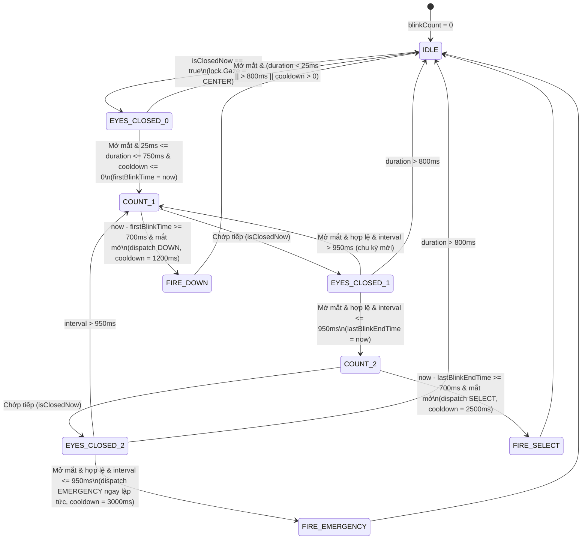
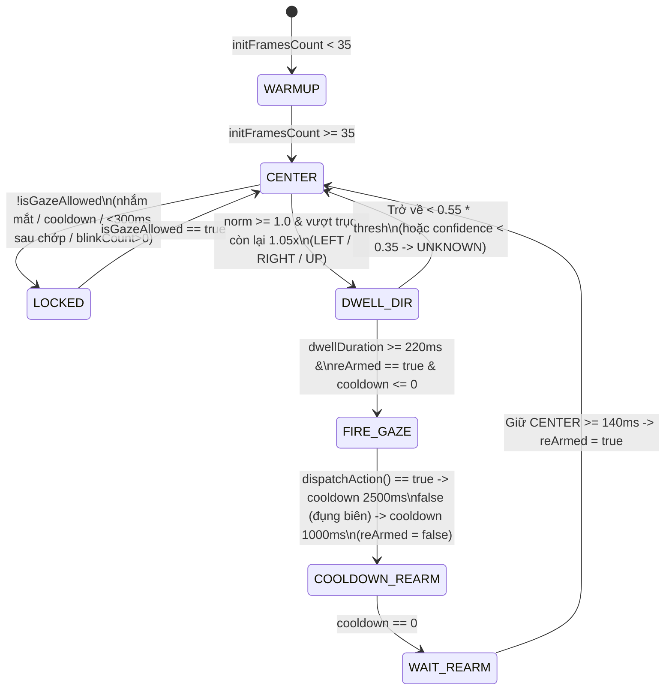

# 04. PHÂN TÍCH CHUYÊN SÂU THUẬT TOÁN VÀ CÔNG THỨC TOÁN HỌC

> Toàn bộ công thức, chỉ số điểm mốc, hằng số và ngưỡng dưới đây được trích xuất nguyên văn từ mã nguồn hiện hành, chủ yếu tại [`eyeTracker.ts`](file:///c:/Users/Admin/Downloads/eyetalk-assistant/src/modules/eye-control/eyeTracker.ts), [`EyeTrackingProvider.tsx`](file:///c:/Users/Admin/Downloads/eyetalk-assistant/src/modules/eye-control/EyeTrackingProvider.tsx), [`lowLightFilter.ts`](file:///c:/Users/Admin/Downloads/eyetalk-assistant/src/modules/eye-control/lowLightFilter.ts), [`EyeNavigationProvider.tsx`](file:///c:/Users/Admin/Downloads/eyetalk-assistant/src/modules/eye-control/EyeNavigationProvider.tsx), [`eyeFocusAutoScroll.ts`](file:///c:/Users/Admin/Downloads/eyetalk-assistant/src/modules/eye-control/eyeFocusAutoScroll.ts) và [`vietnameseTelex.ts`](file:///c:/Users/Admin/Downloads/eyetalk-assistant/src/modules/virtual-keyboard/vietnameseTelex.ts).

---

## 1. Thuật toán Tiền xử lý Thiếu sáng (`lowLightFilter.ts`)

Được kích hoạt tùy chọn (mặc định `OFF` tại [`EyeTrackingProvider.tsx:126`](file:///c:/Users/Admin/Downloads/eyetalk-assistant/src/modules/eye-control/EyeTrackingProvider.tsx#L126)) trước khi đưa frame vào MediaPipe FaceMesh.

### 1.1. Ước lượng độ sáng trung bình theo chuẩn Rec. 601 (`estimateMeanLuminance`, dòng 41–62)
Lấy mẫu nhảy bước (`stride = sampleStep = 8`, tức lấy 1/8 số pixel để giảm chi phí CPU):
$$L_{\text{raw}} = \frac{1}{N_{\text{sampled}}} \sum_{k=0, 8, 16, \dots} \left(0.299 \cdot R_k + 0.587 \cdot G_k + 0.114 \cdot B_k\right) \in [0, 255]$$

### 1.2. Làm mượt độ sáng theo thời gian bằng EMA & Deadband (`updateLuminanceAndGamma`, dòng 130–152)
Với $\alpha_{\text{ema}} = 0.1$:
$$L_{\text{smooth}}^{(t)} = \begin{cases} L_{\text{raw}}^{(0)} & \text{nếu } t = 0 \text{ (chưa có lịch sử)} \\ 0.1 \cdot L_{\text{raw}}^{(t)} + 0.9 \cdot L_{\text{smooth}}^{(t-1)} & \text{nếu } t > 0 \end{cases}$$

### 1.3. Tính Gamma thích nghi (`computeAdaptiveGamma`, dòng 68–91)
Mục tiêu giải phương trình $(L_{\text{smooth}}/255)^{\gamma} = L_{\text{target}}/255$ với $L_{\text{target}} = 125$, kẹp trong $[\gamma_{\min}, \gamma_{\max}] = [0.48, 1.0]$:
$$\gamma_{\text{cand}} = \begin{cases} 1.0 & \text{nếu } L_{\text{smooth}} \ge 125 \text{ hoặc } \neg\text{isFinite}(L_{\text{smooth}}) \\ \text{clamp}\left(\frac{\ln(125 / 255)}{\ln(\max(1, L_{\text{smooth}}) / 255)},\ 0.48,\ 1.0\right) & \text{nếu } L_{\text{smooth}} < 125 \end{cases}$$
- **Gamma Deadband (`gammaDeadband = 0.02`)**: Chỉ cập nhật `currentGamma` và dựng lại LUT khi $|\gamma_{\text{cand}} - \gamma_{\text{prev}}| \ge 0.02$, tránh hiện tượng nhấp nháy độ sáng giữa các frame.
- **Giới hạn $\gamma_{\min} = 0.48$**: Chặn khuếch đại nhiễu hạt (sensor noise) quá mức trong môi trường tối đen.

### 1.4. Bảng tra LUT 256 phần tử (`buildGammaLUT` & `applyGammaLUT`, dòng 97–125)
- Với mỗi mức cường độ $i \in \{0, 1, \dots, 255\}$:
  $$\text{LUT}[i] = \text{clamp}\left(\text{round}\left(255 \cdot \left(\frac{i}{255}\right)^{\gamma}\right),\ 0,\ 255\right)$$
- Khi $\gamma < 0.999$ (`lowLightFilter.ts:238`), duyệt từng pixel RGBA và gán $R' = \text{LUT}[R], G' = \text{LUT}[G], B' = \text{LUT}[B]$, giữ nguyên kênh Alpha $A$.

---

## 2. Thuật toán Hình học Mắt (`eyeTracker.ts`)

### 2.1. Chỉ số điểm mốc MediaPipe sử dụng (`EYE_INDICES`, dòng 19–47)

| Vai trò | Mắt trái (`left`) | Mắt phải (`right`) | Tham chiếu đầu (`face`) |
| :--- | :--- | :--- | :--- |
| Khóe ngoài (Outer Canthus) | `33` | `263` | Đỉnh mũi (`noseTip`): `1` |
| Khóe trong (Inner Canthus) | `133` | `362` | Giữa trán (`glabella`): `10` |
| Mí trên 1 / 2 (`top`, `top2`) | `159`, `158` | `386`, `385` | Cằm (`chin`): `152` |
| Mí dưới 1 / 2 (`bottom`, `bottom2`) | `145`, `144` | `374`, `373` | Má trái / phải (`cheek`): `234`, `454` |
| Tâm mống mắt (`iris`) | `468` (viền `468..472`) | `473` (viền `473..477`) | — |

### 2.2. Eye Aspect Ratio — EAR (`eyeTracker.ts:156-166`)
Dùng khoảng cách Euclid 2D `dist2D(a, b) = Math.hypot(a.x - b.x, a.y - b.y)`:
$$\text{EAR}_{\text{left}} = \frac{\|P_{159} - P_{145}\|_2 + \|P_{158} - P_{144}\|_2}{2 \cdot \max(0.001,\ \|P_{33} - P_{133}\|_2)}$$
$$\text{EAR}_{\text{right}} = \frac{\|P_{386} - P_{374}\|_2 + \|P_{385} - P_{373}\|_2}{2 \cdot \max(0.001,\ \|P_{362} - P_{263}\|_2)}$$
$$\text{EAR}_{\text{avg}} = \frac{\text{EAR}_{\text{left}} + \text{EAR}_{\text{right}}}{2}$$

- **Ý nghĩa**: Khi mắt mở to, tử số lớn → $\text{EAR} \approx 0.25 - 0.38$. Khi nhắm mắt, mí trên chạm mí dưới → tử số tiến về $0$ trong khi mẫu số (chiều rộng khóe mắt) gần như bất biến → $\text{EAR}$ tụt mạnh xuống dưới ngưỡng `blinkThreshold`.
- **Ví dụ tính số**: Giả sử $P_{33}=(0.35, 0.40), P_{133}=(0.43, 0.40) \Rightarrow \text{width} = 0.08$. Hai cặp mí có khoảng cách dọc $0.412 - 0.388 = 0.024 \Rightarrow \text{EAR} = \frac{0.024 + 0.024}{2 \times 0.08} = 0.300$ (khớp chính xác unit test [`lowLightFilter.test.tsx:427-451`](file:///c:/Users/Admin/Downloads/eyetalk-assistant/src/modules/eye-control/__tests__/lowLightFilter.test.tsx#L427-L451)).

### 2.3. Chiếu mống mắt lên hệ quy chiếu khóe mắt (Canthal Baseline Projection — `eyeTracker.ts:188-261`)

Đây là thuật toán cốt lõi **do EYEAI tự thiết kế** nhằm khắc phục nhược điểm của thuật toán cũ trong [`src/utils/eyeTracker.ts`](file:///c:/Users/Admin/Downloads/eyetalk-assistant/src/utils/eyeTracker.ts#L105-L112) (vốn chia tọa độ mống mắt theo mí trên/dưới, dẫn đến khi nhìn xuống mí trên sụp xuống làm tọa độ tương đối bị đảo ngược).

Với **mắt trái** (từ khóe ngoài $P_{33}$ đến khóe trong $P_{133}$):
1. Vector trục khóe mắt và độ dài:
   $$\vec{b}_L = P_{133} - P_{33} = (b_{Lx}, b_{Ly}), \quad L_L = \max(0.001,\ \|\vec{b}_L\|_2)$$
2. Hệ trực chuẩn cục bộ (trong tọa độ ảnh $y$ hướng xuống):
   $$\hat{u}_L = \left(\frac{b_{Lx}}{L_L},\ \frac{b_{Ly}}{L_L}\right) \quad \text{(trục ngang hướng về mũi)}$$
   $$\hat{v}_L = (-u_{Ly},\ u_{Lx}) \quad \text{(quay } 90^\circ \text{ theo chiều kim đồng hồ, hướng XUỐNG DƯỚI)}$$
3. Độ lệch tâm mống mắt $I_L = P_{468}$ so với trung điểm khóe mắt $M_L = \frac{P_{33} + P_{133}}{2}$:
   $$\vec{d}_L = I_L - M_L = (d_{Lx}, d_{Ly})$$
4. Tọa độ chiếu chuẩn hóa theo chiều rộng mắt:
   $$\text{leftIrisH} = \frac{\vec{d}_L \cdot \hat{u}_L}{L_L}, \qquad \text{leftIrisV} = \frac{\vec{d}_L \cdot \hat{v}_L}{L_L}$$

Tương tự với **mắt phải** (vector $\vec{b}_R = P_{263} - P_{362}$ từ khóe trong đến khóe ngoài, cùng hướng $+x$ trong ảnh thô):
$$\text{rightIrisH} = \frac{\vec{d}_R \cdot \hat{u}_R}{L_R}, \qquad \text{rightIrisV} = \frac{\vec{d}_R \cdot \hat{v}_R}{L_R}$$

**Hợp nhất hai mắt có trọng số EAR & Ánh xạ lật gương (Selfie Mirror Mapping)**:
$$w_L = \max(0.01,\ \text{EAR}_{\text{left}} - 0.08), \qquad w_R = \max(0.01,\ \text{EAR}_{\text{right}} - 0.08)$$
$$\text{rawGazeX} = -\frac{w_L \cdot \text{leftIrisH} + w_R \cdot \text{rightIrisH}}{w_L + w_R}, \qquad \text{rawGazeY} = \frac{w_L \cdot \text{leftIrisV} + w_R \cdot \text{rightIrisV}}{w_L + w_R}$$

- **Dấu của $\text{rawGazeX}, \text{rawGazeY}$**:
  - Liếc **PHẢI** trên màn hình selfie → trong ảnh thô chưa lật, đồng tử lệch sang trái ảnh ($\Delta x < 0$) → do có dấu `-` ở đầu, $\text{rawGazeX} > 0$.
  - Liếc **TRÁI** trên màn hình selfie → $\text{rawGazeX} < 0$.
  - Liếc **LÊN** → đồng tử dịch lên ($y$ giảm) → $\text{rawGazeY} < 0$.
  - Liếc **XUỐNG** → đồng tử dịch xuống ($y$ tăng) → $\text{rawGazeY} > 0$.

### 2.4. Ước lượng tư thế đầu & Độ tin cậy (`eyeTracker.ts:265-295`)
- `headYaw = (faceCenterX - nose.x) / (faceWidth * 0.5)` với `faceCenterX = (P234.x + P454.x) / 2`, `faceWidth = max(0.001, dist2D(P234, P454))`.
- `headPitch = (dTop / (dTop + dBottom) - 0.45) * 3.5` với `dTop = dist2D(P10, P1)`, `dBottom = dist2D(P1, P152)`.
- **Lưu ý kiểm toán**: Tại dòng 289–290, `compensatedGazeX = rawGazeX` và `compensatedGazeY = rawGazeY` (không cộng/trừ bù trừ góc đầu theo thiết kế "Pure Iris Position Tracking").
- **Độ tin cậy (`confidence`)**:
  $$\text{confidence} = \begin{cases} \min\left(0.99,\ \max\left(0.3,\ 0.5 + \min\left(1.0,\ \frac{\text{EAR}_{\text{avg}}}{0.22}\right) \cdot 0.45\right)\right) & \text{nếu } \text{faceWidth} > 0.08 \land \text{faceHeight} > 0.10 \\ 0.2 & \text{ngược lại} \end{cases}$$

---

## 3. Thuật toán Xử lý Cử chỉ & Trọng tài Lệnh (`EyeTrackingProvider.tsx`)

### 3.1. Kênh ưu tiên #1: Máy trạng thái Đếm Chớp Mắt (Blink Count FSM — dòng 544–815)

1. **Ngưỡng chớp mắt động & Hysteresis**:
   - $\text{openBaselineEAR} = \text{clamp}(\text{neutralRunningEAR} \lor \text{calibration.neutralEAR} \lor 0.29,\ 0.22,\ 0.42)$
   - $\text{blinkThresh} = \text{calibration.isCalibrated} \ ? \ \text{clamp}(\text{calibration.blinkThreshold}, 0.16, 0.29) \ : \ \text{clamp}(\text{openBaselineEAR} \times 0.78,\ 0.16,\ 0.28)$
   - Ngưỡng có trễ (Hysteresis): $T_{\text{cur}} = \text{isEyesClosed} \ ? \ (\text{blinkThresh} + 0.015) \ : \ \text{blinkThresh}$.
   - Điều kiện mắt đóng: $\text{isClosedNow} \iff (\text{avgEAR} < T_{\text{cur}}) \lor (\text{leftEAR} < T_{\text{cur}} \land \text{rightEAR} < T_{\text{cur}})$.
2. **Hợp lệ một cái chớp mắt (khi mắt vừa mở lại)**:
   - Thời lượng nhắm `blinkDuration = now - closeStartTime`.
   - Hợp lệ nếu `25ms <= blinkDuration <= 750ms` và `cooldownTimer <= 0`.
   - Nếu `blinkDuration > 800ms`: coi là nhắm mắt nghỉ/dài, đặt lại `blinkCountInGesture = 0`.
3. **Cửa sổ quyết định `BLINK_DECISION_WINDOW_MS = 700ms` (dung sai nối tiếp `+250ms = 950ms`)**:
   - **1 chớp → `DOWN`**: Khi `blinkCount === 1`, nếu đã quá `700ms` kể từ `firstBlinkTime` mà không có chớp thứ 2 (và mắt đang mở) → kích hoạt `dispatchAction('DOWN')`, đặt cooldown `1200ms`.
   - **2 chớp → `SELECT`**: Khi `blinkCount === 2`, nếu đã quá `700ms` kể từ `lastBlinkEndTime` mà không có chớp thứ 3 (và mắt đang mở) → kích hoạt `dispatchAction('SELECT')`, đặt cooldown `2500ms`.
   - **3 chớp → `EMERGENCY`**: Ngay tại khoảnh khắc mở mắt của cái chớp thứ 3 (trong vòng `950ms` từ cái thứ 2) → **kích hoạt ngay không chờ timeout** `dispatchAction('EMERGENCY')` + sự kiện `eyeai:emergency`, đặt cooldown `3000ms`.

#### Sơ đồ trạng thái Blink Count FSM

### 3.2. Kênh ưu tiên #2: Phân loại Hướng nhìn, Dwell & Re-Arm (Gaze Classifier FSM — dòng 818–1045)

1. **Auto-Zero Warm-up (35 frame đầu)** & **Drift Compensation**:
   - Khi mới thấy mặt (`initFramesCount < 35`), cập nhật trung tính bằng EMA ($\alpha = 0.25$ cho X/Y, $\alpha = 0.15$ cho EAR nếu $\text{avgEAR} > 0.20$).
   - Sau 35 frame, khi đang ở `CENTER` và mắt mở rõ ($\text{avgEAR} \ge \text{blinkThresh} + 0.025$), bù trôi tư thế rất chậm ($\alpha_{\text{drift}} = 0.012$ cho X/Y, $0.005$ cho EAR).
2. **Cổng an toàn `isGazeAllowed` (dòng 873–881)**:
   Chỉ cho phép tính hướng liếc khi thỏa ĐỒNG THỜI tất cả:
   - `initFramesCount >= 35` (đã qua warm-up)
   - `cooldownTimer <= 0`
   - `!isClosedNow && !isEyesClosed`
   - `metrics.avgEAR >= blinkThresh + 0.015` (không nheo mắt)
   - `now - lastBlinkEndTime >= 300` (tránh nhiễu landmark 300ms sau khi mở mắt)
   - `blinkCountInGesture === 0` (khóa hoàn toàn gaze khi đang dở chuỗi chớp mắt)
   - `actionTriggeredThisFrame === 'NONE'`
3. **Làm mượt EMA & Phân loại kèm Hysteresis**:
   - $\Delta x = \text{compensatedGazeX} - \text{neutralX}$, $\Delta y = \text{compensatedGazeY} - \text{neutralY}$.
   - $\text{smoothX} = 0.45 \cdot \Delta x + 0.55 \cdot \text{smoothX}_{\text{prev}}$ (tương tự $\text{smoothY}$).
   - Ngưỡng kẹp: `threshUp/Down` $\in [0.014, 0.024]$; `threshLeft/Right` $\in [0.020, 0.034]$.
   - Tỷ lệ chuẩn hóa khi đang ở `CENTER`: $\text{normH} = |\text{curGx}| / T_H$, $\text{normV} = |\text{curGy}| / T_V$.
     - Nếu $\text{normH} \ge 1.0 \land \text{normH} > 1.05 \cdot \text{normV}$ → `RIGHT` ($\text{curGx} > 0$) hoặc `LEFT`.
     - Nếu $\text{normV} \ge 1.0 \land \text{normV} > 1.05 \cdot \text{normH}$ → nếu $\text{curGy} < 0$ chọn `UP`, còn $\text{curGy} \ge 0$ giữ **`CENTER`** (tắt liếc xuống, thay bằng 1 chớp mắt).
   - Thoát trạng thái hướng về `CENTER` khi tín hiệu giảm xuống dưới ngưỡng thả `0.55 * thresh` (Hysteresis).
   - Nếu `metrics.confidence < 0.35` → `UNKNOWN`.
4. **Re-Arm (`140ms`) & Dwell Confirmation (`220ms`)**:
   - Sau khi bắn 1 lệnh, `reArmedRef` thành `false`. Để bắn lệnh liếc tiếp theo, người dùng phải đưa mắt về `CENTER` và giữ ổn định `>= 140ms` (`centerStabilityStart`) để `reArmedRef = true` (ngăn cuộn liên thanh ngoài ý muốn khi giữ mắt lệch).
   - Khi ở hướng khác `CENTER`/`UNKNOWN`, bộ đếm `gazeDwellStart` yêu cầu giữ liếc đủ `targetDwellMs = 220ms` mới gọi `dispatchAction(mappedAction)`:
     - Nếu `executed === true`: cooldown `2500ms`, reset gaze về `CENTER`, `reArmedRef = false`.
     - Nếu `executed === false` (đụng biên màn hình): cooldown `1000ms`, phát giọng nói `"Không có phần tử theo hướng này"`.

#### Sơ đồ trạng thái Gaze Classifier & Re-Arm FSM

---

## 4. Thuật toán Hiệu chỉnh 5 hướng (`start5PointCalibration`, dòng 1778–1954)

1. Đếm ngược 3 giây.
2. Thu thập tuần tự 5 bước: `center` → `up` → `down` → `left` → `right`. Mỗi bước lặp tối đa 60 lần (mỗi 55ms), lấy tối đa 32 mẫu có `avgEAR > 0.12 && confidence > 0.4` (tối thiểu phải đạt 15 mẫu).
3. Sắp xếp mảng mẫu và lấy **Trung vị (Median)** để loại bỏ nhiễu ngoại lai (outlier).
4. Tính biên độ dịch chuyển và đặt ngưỡng bằng **50% biên độ**, kẹp trong cận an toàn giải phẫu:
   - `thresholdUp = clamp(|upY - neutralY| * 0.50, 0.014, 0.030)`
   - `thresholdDown = clamp(|downY - neutralY| * 0.50, 0.014, 0.030)`
   - `thresholdLeft = clamp(|leftX - neutralX| * 0.50, 0.020, 0.040)`
   - `thresholdRight = clamp(|rightX - neutralX| * 0.50, 0.020, 0.040)`
   - `blinkThreshold = clamp(neutralEAR * 0.62, 0.12, 0.20)`
5. **Lưu ý kỹ thuật khi khởi động lại app (`EyeTrackingProvider.tsx:200`)**: Khi đọc calibration từ `localStorage`, code ép `isCalibrated: false` để luôn chạy auto-centering 35 frame đầu theo tư thế ngồi mới của phiên đó, nhưng vẫn giữ lại các ngưỡng `thresholdUp/Down/Left/Right` đã lưu (bị kẹp lại ở dòng 194–199).

---

## 5. Thuật toán Điều hướng Giao diện & Cuộn tự động

### 5.1. Điều hướng 2 pha (`EyeNavigationProvider.tsx:276-438`)
- Lọc ứng viên hợp lệ: khớp `activeScopeId` (`scopeStackRef`), `element.isConnected === true`, `rect.width > 0 && rect.height > 0`.
- **Pha 1 — Grid Navigation** (khi `currNode.row !== undefined && currNode.col !== undefined`):
  - `RIGHT`/`NEXT`: Cùng `row`, `col > curr.col`, chọn `col` nhỏ nhất.
  - `LEFT`/`BACK`: Cùng `row`, `col < curr.col`, chọn `col` lớn nhất.
  - `DOWN`: Hàng `row > curr.row` gần nhất, chọn node trong hàng đó có $|n.\text{col} - \text{curr.col}|$ nhỏ nhất.
  - `UP`: Hàng `row < curr.row` gần nhất, chọn node có $|n.\text{col} - \text{curr.col}|$ nhỏ nhất.
- **Pha 2 — Spatial 2D Bounding Box Search** (khi không có grid hoặc không tìm thấy trong grid):
  - Tính vector tâm $(\Delta x, \Delta y) = \text{center}(node) - \text{center}(curr)$ và phần chồng lấn hình học `overlapX`, `overlapY`.
  - Với hướng `RIGHT` ($\Delta x > 4$): Hợp lệ nếu `overlapY > 0` hoặc $|\Delta y| \le 2.2 \cdot \Delta x$ (hình nón góc $\approx 65.5^\circ$). Điểm phạt:
    $$\text{score} = \begin{cases} 0.6 \cdot \Delta x & \text{nếu } \text{overlapY} > 0 \text{ (ưu tiên cùng hàng)} \\ \Delta x + 1.8 \cdot |\Delta y| & \text{nếu không chồng lấn} \end{cases}$$
  - Các hướng `LEFT`, `DOWN`, `UP` đối xứng hoàn toàn. Chọn ứng viên có `score` nhỏ nhất. Không có wrap-around ở biên.

### 5.2. Cuộn tự động vùng an toàn (`eyeFocusAutoScroll.ts:130-276`)
- Nếu phần tử thuộc bàn phím ảo (`groupId === 'virtual-keyboard'` hoặc nằm trong `#smartphone-virtual-keyboard`) → **bỏ qua không cuộn**.
- Tính vùng bị che phía trên (`topOccupied`: `<header>`, `.sticky.top-0`, `#keyboard-eye-hud-bar`) và phía dưới (`bottomOccupied`: `#smartphone-virtual-keyboard`, `--virtual-keyboard-height`, `.fixed.bottom-0`).
- Cộng thêm đệm vòng focus `FOCUS_RING_BUFFER = 18px` + `20px` lề an toàn.
- Cuộn container lồng (`findScrollContainer`) trước, sau đó cuộn `window.scrollBy` nếu độ lệch $> 2\text{px}$.

### 5.3. Bộ gõ Tiếng Việt Telex (`vietnameseTelex.ts`)
- Kiểm tra 2 ký tự cuối `text.slice(-2)` (cặp `nguyên âm + phím dấu s/f/r/x/j`, ví dụ `'as' -> 'á'`, `'ês' -> 'ế'`, `'ơj' -> 'ợ'`, tổng 60 cặp nguyên âm thường + 5 cặp `'as '`..`'aj '` + 5 cặp `'As'`..`'Aj'`).
- Nếu khớp bảng tra `combinations`, thay thế 2 ký tự cuối bằng ký tự có dấu tương ứng. (Không xử lý bỏ dấu lùi nhiều ký tự như `toan + s -> toán` mà chỉ ghép liền kề 2 ký tự cuối).
