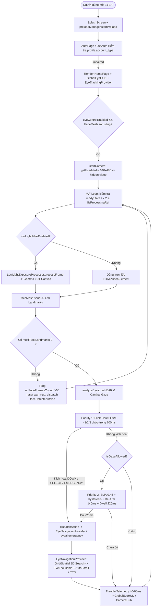
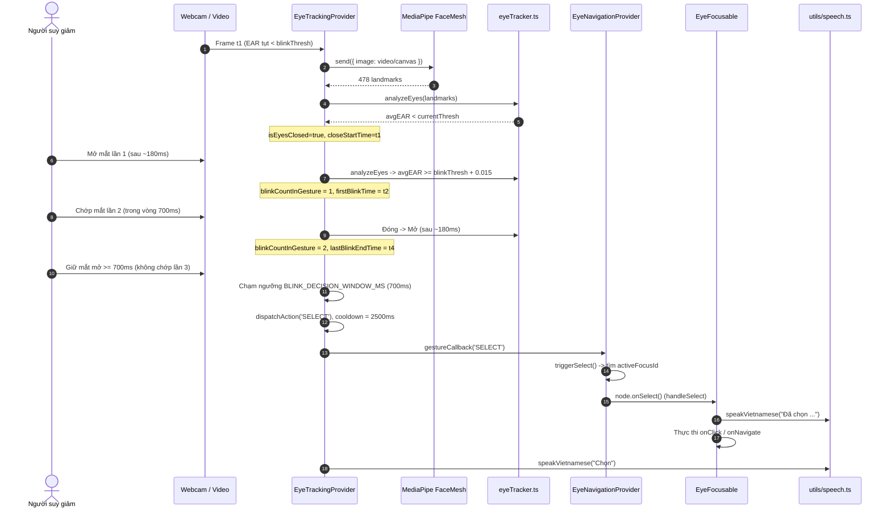

# 07. PHÂN TÍCH WORKFLOW END-TO-END VÀ LUỒNG TÍNH NĂNG

## 1. Workflow tổng thể End-to-End (Từ truy cập đến thực thi hành động mắt)

### Bảng truy vết từng bước thực tế

| Bước | Giai đoạn | File thực hiện | Hàm thực hiện | Dữ liệu đầu vào | Dữ liệu đầu ra | Thành phần tiếp nhận |
| :--- | :--- | :--- | :--- | :--- | :--- | :--- |
| 1 | Khởi tạo ứng dụng & Provider | `src/main.tsx`, `src/App.tsx` | `createRoot`, `App()`, `AppWithPatientMode()`, `AppContent()` | DOM `#root` | Cây Provider (`Tutorial` → `EyeTracking` → `EyeNavigation` → `Call`) | `SplashScreen`, `PreloadManager` |
| 2 | Preload tài nguyên & Auth | `preloadManager.ts`, `useAuth.ts`, `App.tsx` | `preloadManager.startPreload()`, `supabase.auth.getSession()`, `fetchProfile()` | Chunk app, video, Supabase session | `profile.account_type === 'impaired'`, route `'home'` | `HomePage`, `GlobalEyeHUD`, `OnboardingModal` |
| 3 | Nạp mô hình AI & Bật Camera | `EyeTrackingProvider.tsx` | `loadLibraries()`, `startCamera()` | `settings.eyeControlEnabled === true`, `getUserMedia({ video: 640x480 })` | `MediaStream` gắn vào hidden `<video>`, `cameraActive: true` | `startTrackingLoop()`, `CameraPreview` |
| 4 | Thu nhận & Tiền xử lý Frame | `EyeTrackingProvider.tsx`, `lowLightFilter.ts` | `render()` (rAF), `LowLightExposureProcessor.processFrame()` | `HTMLVideoElement` (`readyState >= 2`) | `frameSource` (`video` gốc hoặc `HTMLCanvasElement` đã tăng sáng LUT) | `faceMeshRef.current.send()` |
| 5 | Suy luận AI Landmark | MediaPipe FaceMesh CDN | `faceMesh.send({ image })` → `onResults` | Khung hình ảnh `640×480` | `results.multiFaceLandmarks[0]` (478 điểm `{x,y,z}`) | `processFaceMeshResults()` |
| 6 | Tính hình học mắt | `eyeTracker.ts` | `analyzeEyes(landmarks)` | 478 `Point[]` | `EyeMetrics` (`avgEAR`, `leftEAR`, `rightEAR`, `rawGazeX/Y`, `confidence`, `headYaw/Pitch`) | `processFaceMeshResults()` |
| 7 | Nhận diện cử chỉ (FSM) | `EyeTrackingProvider.tsx` | `processFaceMeshResults()` (Blink FSM + Gaze Classifier FSM) | `EyeMetrics`, `now = performance.now()`, `calibration` | `EyeAction` (`DOWN`, `SELECT`, `EMERGENCY`, `LEFT`, `RIGHT`, `UP`) + `trackingState` | `dispatchAction(action)` |
| 8 | Phát lệnh & Phản hồi âm thanh | `EyeTrackingProvider.tsx`, `speech.ts` | `dispatchAction()`, `speakVietnamese()` | `EyeAction`, `gestureCallbacksRef` | Gọi các callback đã đăng ký; phát TTS (`"Chọn"`, `"Sang phải"`, ...) hoặc sự kiện `eyeai:emergency` | `EyeNavigationProvider` |
| 9 | Điều hướng / Kích hoạt UI | `EyeNavigationProvider.tsx`, `eyeFocusAutoScroll.ts` | `navigate()`, `triggerSelect()`, `triggerEscape()`, `ensureEyeFocusVisible()` | `EyeAction`, `nodesRef`, `scopeStackRef` | Cập nhật `activeFocusId`, cuộn viewport, gọi `node.onSelect()` hoặc `node.element.click()` | `EyeFocusable`, Page handler |
| 10 | Thực thi hành động & Tiếp tục | `EyeFocusable.tsx`, Pages, `EyeTrackingProvider.tsx` | `handleSelect()`, handler trang (`onNavigate`, `handleKeyPress`, ...), `requestAnimationFrame(render)` | Sự kiện chọn / điều hướng | Đổi route / gõ phím / phát loa / gọi AI / SOS; đồng thời vòng rAF tiếp nhận frame kế tiếp | Vòng lặp frame mới |

### Sơ đồ Flowchart tổng thể

### Sơ đồ Sequence Diagram End-to-End (Một chu kỳ chọn bằng chớp mắt 2 cái)

---

## 2. Phân tích 13 Workflow tính năng thực tế

### 2.1. Khởi động hệ thống (`App.tsx`, `SplashScreen.tsx`, `preloadManager.ts`)
1. `AppContent` mount, gọi `preloadManager.startPreload()`.
2. 10 task chạy tuần tự: font → video `/login_register.mp4` → `supabase.auth.getSession()` → core UI chunks → Home/Speak chunks → Auth chunks → Settings/AI → SOS/Entertainment → Location/Contacts/Chat → VirtualKeyboard.
3. Khi `progress === 100`, người dùng chạm/nhấn phím để `SplashScreen` gọi `onSplashFinished()` (`setIsSplashActive(false)`).
4. Nếu chưa đăng nhập → hiện `AuthPage`. Sau khi đăng nhập `impaired` → `openTutorial()` + `navigateTo('home')` + render `GlobalEyeHUD`.

### 2.2. Bật và tắt Camera (`EyeTrackingProvider.tsx`, `GlobalEyeHUD.tsx`, `PageHeader.tsx`, `SettingsPage.tsx`)
- **Bật**: Khi `eyeControlEnabled` bật (qua `PageHeader`, `GlobalEyeHUD` nút "Bật Camera HUD", hoặc `SettingsPage`), `useEffect` gọi `startCamera()` → kiểm tra `window.isSecureContext` & `navigator.mediaDevices.getUserMedia` → xin stream `640×480` → gán `videoRef.current.srcObject` → `video.play()` → `startTrackingLoop()` → `recoverAudioSession()`.
- **Tắt**: Gọi `stopTrackingLoop()` (hoặc `setEyeControlEnabled(false)`) → `cancelAnimationFrame` → `track.stop()` trên mọi track → xóa `srcObject` → `lowLightProcessorRef.current?.reset()` → đặt `cameraActive: false` → `recoverAudioSession()`.

### 2.3. Hiệu chỉnh mắt 5 hướng & Căn tâm nhanh (`EyeTrackingProvider.tsx`, `CameraHub.tsx`)
- **Căn tâm nhanh (`reZeroCenter`)**: Lấy ngay `latestMetricsRef.current.compensatedGazeX/Y` làm `neutralRunningX/Y`, lưu vào `calibration` (`localStorage`) và nói `"Đã căn tâm"`.
- **Hiệu chỉnh 5 điểm (`start5PointCalibration`)**: Hiển thị overlay toàn `CameraHub` → đếm ngược 3s → lần lượt thu 32 mẫu (tối thiểu 15) cho `center`, `up`, `down`, `left`, `right` → tính Median → cập nhật ngưỡng `thresholdUp/Down/Left/Right` (50% biên độ) và `blinkThreshold` (`0.62 * neutralEAR`) → lưu `eyeai_calibration` & `luckydream_eye_calibration`.

### 2.4. Nhận diện cử chỉ mắt (`EyeTrackingProvider.tsx:538-1045`)
- Tách làm 2 luồng ưu tiên:
  - Luồng chớp mắt luôn đánh giá trước và khóa cứng gaze về `CENTER` trong lúc nhắm mắt, 300ms sau khi mở mắt, và suốt khi `blinkCount > 0`.
  - Luồng liếc mắt chỉ chạy khi `isGazeAllowed === true`, qua EMA (`0.45`), phân loại hysteresis (`0.55`), dwell `220ms`, re-arm `140ms`.

### 2.5. Điều hướng giao diện (`EyeNavigationProvider.tsx`, `Modal.tsx`)
- Trên `HomePage`, các thẻ khai báo tọa độ lưới tường minh `(row, col)`: `SpeakHeroCard(0,0)`, `Entertainment(1,0)`, `Location(1,1)`, `Contacts(2,0)`, `Ai(2,1)`, `Sos(3,0)`.
- Liếc `RIGHT`/`LEFT`/`UP` hoặc chớp 1 cái (`DOWN`) dịch chuyển `activeFocusId` giữa các node cùng `activeScopeId`.
- Khi mở `Modal`, `pushFocusScope(modalScopeId)` cô lập điều hướng vào bên trong modal; khi đóng `popFocusScope` trả focus về nút đã mở modal trước đó.

### 2.6. Chọn phần tử (`EyeFocusable.tsx`, `EyeNavigationProvider.tsx`)
- Chớp 2 cái (hoặc bấm `Enter` / `Space×2` ở Simulator Mode, hoặc click chuột) → `triggerSelect()` → `handleSelect()` của `EyeFocusable` → chống dội `350ms` → hiệu ứng thu phóng `isSelecting` (`180ms`) → đọc `"Đã chọn <tên>"` → gọi `onSelect()`.

### 2.7. Cuộn trang (`eyeFocusAutoScroll.ts`)
- Mỗi khi `activeFocusId` hoặc `isKeyboardOpen` thay đổi, `EyeNavigationProvider` gọi `requestAnimationFrame(() => ensureEyeFocusVisible(activeFocusId, nodesRef.current))`.
- Hệ thống đo chiều cao thanh trên (`header`, `#keyboard-eye-hud-bar`) và chiều cao bàn phím dưới (`#smartphone-virtual-keyboard`), tự cuộn container lồng hoặc `window` để phần tử luôn nằm trọn trong vùng nhìn an toàn.

### 2.8. Quay lại / Hủy thao tác (`EyeNavigationProvider.tsx:479-515`, `App.tsx:167-177`)
- Khi kích hoạt `triggerEscape()` (qua Escape key, hoặc `ESCAPE` / `DOUBLE_BLINK` callback):
  1. Gọi `escapeHandlersRef` trên đỉnh stack (ví dụ đóng `Modal`).
  2. Nếu không có handler, pop `scopeStackRef` nếu đang trong scope.
  3. Nếu không có scope, tìm và click nút Back (`#btn-header-back`, `#btn-speak-back`, `#btn-ai-back`, `#btn-chat-back`, `#btn-player-back`, `[data-eye-back="true"]`).
  4. Cuối cùng phát `window.dispatchEvent(new CustomEvent('eyeai:escape'))` để `AppContent` điều hướng về `'home'`.
- *Ghi chú mã nguồn*: Trong `EyeTrackingProvider.tsx`, cử chỉ chớp mắt 2 lần đã được đổi chức năng thành `SELECT` (chọn phần tử), nên `DOUBLE_BLINK`/`ESCAPE` chỉ còn được kích hoạt qua phím `Escape` ở Simulator Mode hoặc gọi trực tiếp `triggerEscape()`.

### 2.9. Tương tác với Trợ lý AI (`AiPage.tsx`, `server.ts`, `netlify/functions/ai-chat.ts`)
1. Người dùng chọn câu gợi ý `SUGGESTED_PROMPTS` hoặc gõ nội dung bằng `VirtualKeyboard` + `EyeTextComposer` và chọn `GỬI AI`.
2. `AiPage.handleSend()` chuyển `Avatar3D` sang `THINKING`, gửi `POST /api/ai/chat` kèm `history` (10 tin gần nhất) và timeout 15 giây (`AbortController`).
3. Nếu `/api/ai/chat` không khả dụng (static host không proxy), `fetchDirectGemini()` tự động fallback sang `@google/genai` SDK rồi REST `generativelanguage.googleapis.com`.
4. Nhận phản hồi → thêm tin nhắn vào stream → nếu không trong cuộc gọi (`!isCallActive`), chuyển `Avatar3D` sang `SPEAKING` và gọi `speakVietnamese(reply)`.

### 2.10. Xử lý Giọng nói và Âm thanh (`src/utils/speech.ts`, `AudioUnlockBanner.tsx`, `netlify/functions/tts.ts`)
1. Khi người dùng chạm lần đầu (`AudioUnlockBanner` hoặc `pointerdown/touchstart/click/keydown` listener toàn cục), `unlockAudio()` mở khóa `AudioContext`, `HTMLAudioElement` (bằng WAV câm base64) và hàng đợi `speechSynthesis` trên iOS.
2. Khi gọi `speakVietnamese(text)`: làm sạch markdown (`cleanTextForSpeech`) → gọi `recoverAudioSession()` → dừng câu đọc cũ (`stopSpeech()`).
3. Nếu thiết bị có giọng tiếng Việt bản địa (`hasNativeVietnameseSpeech()` — Edge HoaiMy/NamMinh, iOS, Android) → dùng `window.speechSynthesis` (0ms độ trễ mạng).
4. Ngược lại (Chrome Desktop Windows) → tách thành đoạn $\le 150$ ký tự → kiểm tra RAM cache `audioBufferCache` (tối đa 60 mục) → gọi `/api/tts?text=...` (proxy tới `translate.google.com/translate_tts`) → giải mã `decodeAudioData` và phát qua `Web Audio API` (fallback `HTMLAudioElement`).

### 2.11. Xử lý khi Camera không nhận diện được khuôn mặt (`EyeTrackingProvider.tsx:471-510`)
- Khi `results.multiFaceLandmarks?.[0]` rỗng:
  - Tăng `noFaceFramesCount`. Nếu `> 60` frame liên tiếp (~2 giây ở 30 FPS), đặt lại `initFramesCount = 0` để khi người dùng quay lại sẽ auto-zero lại từ đầu.
  - Vẫn tiếp tục đếm giảm `cooldownTimer`.
  - Đặt `faceDetected: false`, `eyesClosed: false`, `gazeDirection: 'UNKNOWN'`, `blinkCount: 0`, `confidence: 0`.
  - Cập nhật `trackingState` cho HUD hiển thị `"CHƯA THẤY"` / viền xám.

### 2.12. Xử lý lỗi (`EyeTrackingProvider.tsx`, `ErrorBoundary.tsx`, `CameraPreview.tsx`)
- **Lỗi thiếu HTTPS / không có `getUserMedia` / từ chối quyền camera**: Ghi thông báo tiếng Việt vào `trackingState.cameraError`, hiển thị màn hình lỗi đỏ trong `CameraPreview.tsx`.
- **Lỗi `LowLightExposureProcessor`**: Khối `try/catch` trong `render()` (`EyeTrackingProvider.tsx:1502-1506`) bắt lỗi canvas/readback và fallback an toàn về `raw video` để không đứt vòng tracking.
- **Lỗi `faceMesh.send()`**: Catch lỗi tại dòng 1511–1515, luôn giải phóng `isProcessingRef.current = false` trong `finally` để vòng lặp không bị treo vĩnh viễn.
- **Lỗi Render React**: `ErrorBoundary.tsx` bọc toàn app cung cấp nút `"Tải lại ứng dụng"`.

### 2.13. Kết thúc phiên sử dụng
- Người dùng tắt camera hoặc đăng xuất (`ContactsPage` / `SettingsPage` → `signOut()`).
- Khi `isAuthenticated` thành `false`, `AppContent` ẩn `GlobalEyeHUD` và chuyển về `AuthPage`. Khi `EyeTrackingProvider` unmount (hoặc `eyeControlEnabled = false`), `stopTrackingLoop()` giải phóng toàn bộ track camera và `lowLightProcessor.dispose()` giải phóng bộ nhớ canvas.
