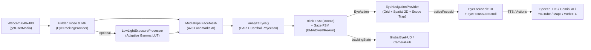

# EYEAI — TÀI LIỆU PHÂN TÍCH KỸ THUẬT CHUYÊN SÂU TOÀN DIỆN (PHÂN HỆ NGƯỜI SUY GIẢM)

> **Dự án**: LUCKY DREAM – EYEAI (`eyetalk-assistant`)  
> **Phạm vi**: Phân hệ dành cho **Người suy giảm (`profile.account_type === 'impaired'`)** và các module dùng chung liên quan trực tiếp.  
> **Bộ tài liệu chi tiết đi kèm**: Xem [`00_MASTER_INDEX.md`](./00_MASTER_INDEX.md) để tra cứu các chuyên khảo độc lập (`01` đến `11`).

---

## 1. Kiến trúc tổng thể & Tech Stack

### 1.1. Mô hình kiến trúc
Phân hệ Người suy giảm là một **Single-Page Application (React 19 + TypeScript + Vite)** kết hợp **Edge Computer Vision chạy 100% trên trình duyệt** và **Cloud BaaS / Serverless Proxies**:
- **Phân tách 2 trải nghiệm tại [`App.tsx`](file:///c:/Users/Admin/Downloads/eyetalk-assistant/src/App.tsx#L192-L213)**: Khi `profile.account_type === 'impaired'`, hệ thống kích hoạt `GlobalEyeHUD`, cho phép điều hướng rảnh tay trên 9 màn hình (`home`, `speak`, `ai`, `sos`, `entertainment`, `location`, `contacts`, `chat`, `settings`) và route legacy `dev-dashboard`. Khi `account_type === 'patient'`, `App.tsx:75-79` tự động tắt `eyeControlEnabled` và ẩn toàn bộ HUD mắt.
- **Chuỗi Provider gốc (`App.tsx:613-627`)**:
  `ErrorBoundary` → `TutorialProvider` → `EyeTrackingProvider` → `EyeNavigationProvider` → `CallProvider` → `PatientModeProvider` → `AppContent`.
- **Tối ưu hiệu năng React bằng Split Context (`EyeTrackingProvider.tsx:55-56`)**:
  - `EyeTrackingSettingsContext`: Chứa cấu hình, calibration, refs camera/canvas và các callback đăng ký ổn định.
  - `EyeTrackingTelemetryContext`: Chứa `trackingState` cập nhật được throttle ở `65ms` (`40ms` khi đang đếm chớp mắt), giúp các thẻ `EyeFocusable` không bị re-render theo tốc độ camera.
- **Truyền dữ liệu tần suất cao không qua React State**:
  - Trạng thái tức thời của bộ lọc & FSM (`smoothGazeX/Y`, `neutralRunningX/Y/EAR`, `isEyesClosed`, `blinkCountInGesture`, `cooldownTimer`, `reArmedRef`) giữ trong `useRef`.
  - Mảng 478 điểm mốc từ MediaPipe được gán vào `window.__eyeai_latest_landmarks` (`EyeTrackingProvider.tsx:468`) để `LiveCameraOverlay.tsx` và `FaceMeshVisualizer.tsx` vẽ ở 60 FPS.

### 1.2. Sơ đồ kiến trúc End-to-End

---

## 2. Bản đồ Module & Trách nhiệm cốt lõi

| Nhóm Module | Các file chính | Trách nhiệm |
| :--- | :--- | :--- |
| **Core Eye-Control** | [`types.ts`](file:///c:/Users/Admin/Downloads/eyetalk-assistant/src/modules/eye-control/types.ts), [`eyeTracker.ts`](file:///c:/Users/Admin/Downloads/eyetalk-assistant/src/modules/eye-control/eyeTracker.ts), [`lowLightFilter.ts`](file:///c:/Users/Admin/Downloads/eyetalk-assistant/src/modules/eye-control/lowLightFilter.ts), [`EyeTrackingProvider.tsx`](file:///c:/Users/Admin/Downloads/eyetalk-assistant/src/modules/eye-control/EyeTrackingProvider.tsx), [`useEyeTracking.ts`](file:///c:/Users/Admin/Downloads/eyetalk-assistant/src/modules/eye-control/useEyeTracking.ts) | Thu nhận camera, tiền xử lý thiếu sáng, suy luận MediaPipe, tính hình học mắt, chạy FSM nhận diện cử chỉ, 5-point calibration & Simulator Mode |
| **Navigation & Focus** | [`EyeNavigationProvider.tsx`](file:///c:/Users/Admin/Downloads/eyetalk-assistant/src/modules/eye-control/EyeNavigationProvider.tsx), [`useEyeNavigation.ts`](file:///c:/Users/Admin/Downloads/eyetalk-assistant/src/modules/eye-control/useEyeNavigation.ts), [`EyeFocusScopeContext.ts`](file:///c:/Users/Admin/Downloads/eyetalk-assistant/src/modules/eye-control/EyeFocusScopeContext.ts), [`EyeFocusable.tsx`](file:///c:/Users/Admin/Downloads/eyetalk-assistant/src/modules/eye-control/EyeFocusable.tsx), [`eyeFocusAutoScroll.ts`](file:///c:/Users/Admin/Downloads/eyetalk-assistant/src/modules/eye-control/eyeFocusAutoScroll.ts) | Quản lý cây phần tử tương tác, Focus Trap trong Modal, điều hướng 2 pha (Grid + Spatial 2D), cuộn an toàn tránh HUD/bàn phím |
| **Camera HUD & Visual** | [`GlobalEyeHUD.tsx`](file:///c:/Users/Admin/Downloads/eyetalk-assistant/src/components/ui/GlobalEyeHUD.tsx), [`KeyboardHudSlot.tsx`](file:///c:/Users/Admin/Downloads/eyetalk-assistant/src/components/ui/KeyboardHudSlot.tsx), [`CameraHub.tsx`](file:///c:/Users/Admin/Downloads/eyetalk-assistant/src/modules/eye-control/CameraHub.tsx), [`CameraPreview.tsx`](file:///c:/Users/Admin/Downloads/eyetalk-assistant/src/modules/eye-control/CameraPreview.tsx), [`LiveCameraOverlay.tsx`](file:///c:/Users/Admin/Downloads/eyetalk-assistant/src/modules/eye-control/LiveCameraOverlay.tsx), [`FaceMeshVisualizer.tsx`](file:///c:/Users/Admin/Downloads/eyetalk-assistant/src/modules/eye-control/FaceMeshVisualizer.tsx) | Hiển thị trạng thái mắt, lưới mesh 2D/3D, thước EAR, bộ đếm chớp, test thủ công, bật lọc thiếu sáng & hiệu chuẩn |
| **Virtual Keyboard** | [`VirtualKeyboard.tsx`](file:///c:/Users/Admin/Downloads/eyetalk-assistant/src/modules/virtual-keyboard/VirtualKeyboard.tsx), [`EyeTextComposer.tsx`](file:///c:/Users/Admin/Downloads/eyetalk-assistant/src/modules/virtual-keyboard/EyeTextComposer.tsx), [`keyboardLayout.ts`](file:///c:/Users/Admin/Downloads/eyetalk-assistant/src/modules/virtual-keyboard/keyboardLayout.ts), [`vietnameseTelex.ts`](file:///c:/Users/Admin/Downloads/eyetalk-assistant/src/modules/virtual-keyboard/vietnameseTelex.ts) | Bàn phím QWERTY / Số / Mẫu câu y tế điều khiển bằng mắt, ghép dấu Telex tiếng Việt, thông báo chiều cao cho auto-scroll |
| **Impaired Pages** | [`HomePage.tsx`](file:///c:/Users/Admin/Downloads/eyetalk-assistant/src/pages/HomePage.tsx), [`SpeakPage.tsx`](file:///c:/Users/Admin/Downloads/eyetalk-assistant/src/pages/SpeakPage.tsx), [`AiPage.tsx`](file:///c:/Users/Admin/Downloads/eyetalk-assistant/src/pages/AiPage.tsx), [`SosPage.tsx`](file:///c:/Users/Admin/Downloads/eyetalk-assistant/src/pages/SosPage.tsx), [`EntertainmentPage.tsx`](file:///c:/Users/Admin/Downloads/eyetalk-assistant/src/pages/EntertainmentPage.tsx), [`LocationPage.tsx`](file:///c:/Users/Admin/Downloads/eyetalk-assistant/src/pages/LocationPage.tsx), [`ContactsPage.tsx`](file:///c:/Users/Admin/Downloads/eyetalk-assistant/src/pages/ContactsPage.tsx), [`HumanChatPage.tsx`](file:///c:/Users/Admin/Downloads/eyetalk-assistant/src/pages/HumanChatPage.tsx), [`SettingsPage.tsx`](file:///c:/Users/Admin/Downloads/eyetalk-assistant/src/pages/SettingsPage.tsx) | Các màn hình chức năng thực tế của người suy giảm (Nói chuyện, AI, SOS, YouTube, GPS, Danh bạ, Chat, Cài đặt) |
| **Shared Services & Backend** | [`speech.ts`](file:///c:/Users/Admin/Downloads/eyetalk-assistant/src/utils/speech.ts), [`CallProvider.tsx`](file:///c:/Users/Admin/Downloads/eyetalk-assistant/src/modules/calls/CallProvider.tsx), [`server.ts`](file:///c:/Users/Admin/Downloads/eyetalk-assistant/server.ts), [`ai-chat.ts`](file:///c:/Users/Admin/Downloads/eyetalk-assistant/netlify/functions/ai-chat.ts), [`tts.ts`](file:///c:/Users/Admin/Downloads/eyetalk-assistant/netlify/functions/tts.ts), [`youtubeBackend.ts`](file:///c:/Users/Admin/Downloads/eyetalk-assistant/server/youtubeBackend.ts) | TTS tiếng Việt đa nền tảng, gọi thoại WebRTC giữ camera eye-tracking, proxy Gemini/TTS/YouTube |

---

## 3. Phân biệt AI và Thuật toán truyền thống

- **AI thực sự dùng trong phân hệ**:
  1. **Google MediaPipe FaceMesh** (`refineLandmarks: true`): Mạng CNN tiền huấn luyện chạy cục bộ trên trình duyệt qua CDN, suy luận `478` tọa độ chuẩn hóa `(x, y, z)` (468 điểm khuôn mặt + 10 điểm mống mắt `468–477`). MediaPipe **chỉ** cung cấp tọa độ điểm mốc, không phân loại hướng nhìn hay chớp mắt.
  2. **Google Gemini API**: LLM đám mây phục vụ hội thoại tiếng Việt trong `AiPage.tsx`.
- **Thuật toán do đội ngũ EYEAI tự xây dựng trên nền tọa độ MediaPipe**:
  1. **Low-Light Adaptive Gamma LUT (`lowLightFilter.ts`)**: Rec. 601 Luminance (`sampleStep=8`) + EMA (`0.1`) + Adaptive Gamma (`[0.48, 1.0]`, target `125`) + Deadband (`0.02`) + 256-entry `Uint8Array` LUT.
  2. **EAR & Canthal Baseline Projection (`eyeTracker.ts`)**:
     - $\text{EAR}_{\text{left}} = \frac{\|P_{159}-P_{145}\|_2 + \|P_{158}-P_{144}\|_2}{2 \cdot \|P_{33}-P_{133}\|_2}$ (tương tự mắt phải `386,374,385,373` / `362,263`).
     - Chiếu độ lệch tâm mống mắt (`468`, `473`) lên hệ trực chuẩn gắn với đường nối 2 khóe mắt (`33-133`, `362-263`) để loại bỏ lỗi đảo hướng nhìn xuống do sụp mí.
     - Hợp nhất hai mắt theo trọng số $w = \max(0.01, \text{EAR} - 0.08)$ và đảo dấu X cho camera lật gương.
  3. **Dual-Channel Temporal FSM (`EyeTrackingProvider.tsx`)**:
     - **Kênh #1 — Blink Count FSM**: Ngưỡng động $\text{clamp}(\text{openBaselineEAR} \times 0.78,\ 0.16,\ 0.28)$ + hysteresis mở mắt `+0.015`, thời lượng chớp hợp lệ `25–750ms`, cửa sổ quyết định `700ms` (dung sai nối `950ms`): **1 chớp → `DOWN`** (`1200ms` cooldown), **2 chớp → `SELECT`** (`2500ms` cooldown), **3 chớp → `EMERGENCY`** tức thì (`3000ms` cooldown).
     - **Kênh #2 — Gaze Classifier FSM**: Warm-up 35 frame (`α=0.25`), drift compensation (`α=0.012`), khóa chéo (`isGazeAllowed`), EMA (`α=0.45`), phân loại `LEFT / RIGHT / UP` (tắt `DOWN`), release hysteresis `0.55 × thresh`, Re-Arm tại `CENTER >= 140ms`, Dwell `220ms`, cooldown `2500ms` (`1000ms` nếu đụng biên).
  4. **Điều hướng 2 pha & Focus Trap (`EyeNavigationProvider.tsx`)**: Grid `(row, col, groupId)` ưu tiên trước, Spatial 2D Bounding Box Scoring (`0.6*d` nếu cùng dải vs `d + 1.8*d_perp`) làm fallback, cô lập Modal qua `scopeStackRef`.

---

## 4. Tóm tắt Kiểm toán Kỹ thuật & Các điểm cần lưu ý

1. **Những điểm mạnh đã xác minh**: Xử lý thị giác 100% client-side bảo mật quyền riêng tư; kiến trúc Split Context + backpressure lock `isProcessingRef` chống nghẽn frame; Canthal Baseline Projection khắc phục triệt để lỗi sụp mí; hỗ trợ đầy đủ cả chế độ thiếu sáng lẫn WebRTC voice call không xung đột camera.
2. **Các hạn chế / sai lệch đã xác minh trong mã nguồn**:
   - Sai lệch giữa văn bản hướng dẫn (`OnboardingModal.tsx`: nói "nháy 2 lần < 1.5s", "liếc 4 hướng", "chỉnh dwell 1.5s") và code thực thi (`EyeTrackingProvider.tsx`: cửa sổ `700ms` cho 1/2/3 chớp, tắt liếc xuống, `targetDwellMs = 220` cố định chưa nối `settings.dwellTimeMs`).
   - `headYaw`/`headPitch` được tính trong `eyeTracker.ts` nhưng chưa áp dụng bù trừ vào `compensatedGazeX/Y` (`lines 289-290`).
   - `CameraHub.tsx:70-78` chạy `setNowTime(performance.now())` trong `requestAnimationFrame` gây re-render `CameraHub` ở 60 FPS khi mở bảng Hub.
   - `SosPage.tsx` và `LocationPage.tsx` hiện thực hiện mô phỏng UI/TTS cho cuộc gọi khẩn cấp 115 và chia sẻ vị trí chứ chưa nối cổng viễn thông/API lưu tọa độ thật.
   - Tồn tại một số file di sản không dùng trong runtime chính (`src/utils/eyeTracker.ts`, `src/utils/keyboardLayout.ts`, `EyeFocusRing.tsx`, `EyeTalkDashboard.tsx`).
3. **Tính trung thực số liệu**: Repository chưa có dữ liệu đo thực nghiệm FPS/latency/accuracy trên người dùng thật; mọi mô phỏng số trong [`08_EXECUTION_SIMULATION.md`](./08_EXECUTION_SIMULATION.md) đều được gắn nhãn số liệu giả lập.

---

## 5. Danh mục liên kết nhanh toàn bộ tài liệu

- [`00_MASTER_INDEX.md`](./00_MASTER_INDEX.md) — Mục lục & Bảng thông số cốt lõi
- [`01_SYSTEM_ARCHITECTURE.md`](./01_SYSTEM_ARCHITECTURE.md) — Kiến trúc hệ thống, Context/Provider & Design Patterns
- [`02_FILE_ANALYSIS.md`](./02_FILE_ANALYSIS.md) — Cây thư mục & Phân tích 86 file liên quan
- [`03_FUNCTION_ANALYSIS.md`](./03_FUNCTION_ANALYSIS.md) — Phân tích hàm Phần 1: Core Eye-Control
- [`03_FUNCTION_ANALYSIS_NAVIGATION_HUD.md`](./03_FUNCTION_ANALYSIS_NAVIGATION_HUD.md) — Phân tích hàm Phần 2: Navigation, Overlay, Hub & HUD
- [`03_FUNCTION_ANALYSIS_KEYBOARD_PAGES.md`](./03_FUNCTION_ANALYSIS_KEYBOARD_PAGES.md) — Phân tích hàm Phần 3: Virtual Keyboard, App, Pages & UI
- [`03_FUNCTION_ANALYSIS_SERVICES_BACKEND.md`](./03_FUNCTION_ANALYSIS_SERVICES_BACKEND.md) — Phân tích hàm Phần 4: Speech, Calls, Services & Backend
- [`04_ALGORITHMS_AND_MATHEMATICS.md`](./04_ALGORITHMS_AND_MATHEMATICS.md) — Thuật toán, công thức toán học & Sơ đồ trạng thái FSM
- [`05_AI_AND_COMPUTER_VISION.md`](./05_AI_AND_COMPUTER_VISION.md) — Phân biệt AI (MediaPipe, Gemini) và Thuật toán truyền thống
- [`06_TECHNICAL_CONCEPTS.md`](./06_TECHNICAL_CONCEPTS.md) — Từ điển khái niệm kỹ thuật gắn với mã nguồn
- [`07_SYSTEM_WORKFLOW.md`](./07_SYSTEM_WORKFLOW.md) — Luồng End-to-End & 13 Workflow tính năng
- [`08_EXECUTION_SIMULATION.md`](./08_EXECUTION_SIMULATION.md) — Mô phỏng từng bước với số liệu khớp công thức
- [`09_TECHNICAL_EVALUATION.md`](./09_TECHNICAL_EVALUATION.md) — Đánh giá kỹ thuật khách quan & Kiểm toán sai lệch
- [`10_TECHNICAL_QA.md`](./10_TECHNICAL_QA.md) — 65 Câu hỏi & Trả lời phản biện kỹ thuật
- [`11_SOURCE_COVERAGE.md`](./11_SOURCE_COVERAGE.md) — Bảng đối chiếu độ bao phủ mã nguồn
